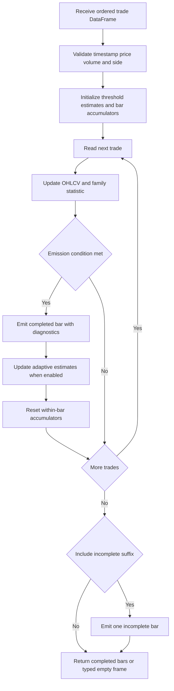

# Alternative Bar Sampling

Alternative bars turn an ordered stream of trades into OHLCV observations when an **activity or order-flow condition** is met. They are not clock-time grids: a busy period can emit many bars quickly, while a quiet period may emit none. This makes the sampling boundary part of the feature definition and therefore part of the temporal contract; see [Temporal Data Contracts](../concepts/temporal-data-contracts.md) and [Feature Computation](feature-computation.md).

The public entry point is a sampler object's `sample(data, include_incomplete=False)` method. `ml4t.engineer.bars` exports vectorized implementations as the default `TickBarSampler`, `VolumeBarSampler`, `DollarBarSampler`, and `ImbalanceBarSampler`; the loop-based counterparts remain available with an `Original` suffix. Fixed, window-based, and run samplers are exported directly.

## Shared input and output contract

Every sampler first validates a Polars `DataFrame` with:

- `timestamp`: non-null Polars `Datetime`, sorted in nondecreasing order;
- `price`: non-null, numeric, finite, and strictly positive;
- `volume`: non-null, numeric, finite, and nonnegative;
- `side`, when present: non-null numeric values exactly `+1` or `-1`.

Equal timestamps are legal and retain input order, so callers must establish the intended trade ordering before sampling. Unsorted input raises `DataValidationError` rather than being silently sorted. Constructor thresholds and expected sizes must be positive; adaptive parameters additionally constrain `alpha` to `(0, 1]`, `initial_p_buy` to `[0, 1]`, and warm-up counts to nonnegative values.

### Side classification is upstream

Tick and dollar bars do not need `side`; the default volume bars need it to report buy/sell volume, and every imbalance or run sampler requires it. Samplers do **not** infer direction internally. If the source has no aggressor flag, classify trades before calling `sample`. The repository's `effective_tick_rule` expression maps upticks to `+1`, downticks to `-1`, and carries the previous nonzero direction across unchanged prices. It returns `0` when direction is unresolved, including the initial observation, so those rows must be resolved or excluded before passing the result as `side`; the sampler contract rejects `0`.

### Common bar shape

All emitted bars contain:

- the first trade timestamp in the bar;
- `open` and `close` from the first and last trade;
- maximum `high`, minimum `low`, summed `volume`, and `tick_count`.

Family-specific diagnostics are added rather than replacing this shape: buy/sell volume, VWAP and dollar volume, imbalance thresholds, or run statistics. Empty input and a nonempty stream that forms no completed bar return the same typed, non-null-schema empty frame for that sampler. Count fields use integer types and other empty-result fields use floating-point types.

By default, only threshold-complete bars are returned. With `include_incomplete=True`, the unconsumed suffix is emitted as one final bar even though it has not met the threshold. Tests assert that this mode preserves the total input tick count and volume. A threshold-crossing trade remains wholly in the bar that it completes: volume or dollar excess is not split or carried into the next bar.

## Accumulation and emission lifecycle

*Each trade is consumed once in order; a boundary emission optionally updates estimates and always starts fresh within-bar accumulation.*

`sample` is batch-oriented, not a streaming continuation protocol. Within-bar accumulators are recreated for each call, so splitting one stream across calls is not equivalent to sampling the concatenated frame. The adaptive volume-imbalance implementations also cache their first estimated mean volume and buy-volume values on the sampler instance; reuse can therefore seed later calls from the first nonempty sample. Prefer a fresh sampler when independent datasets must have independent initialization.

## Standard activity bars

| Family | Statistic and boundary | Additional output | Practical meaning |
|---|---|---|---|
| Tick | emit every `ticks_per_bar` rows | none beyond OHLCV | constant trade count, variable elapsed time and volume |
| Volume | emit when cumulative `volume >= volume_per_bar` | `buy_volume`, `sell_volume` | constant target traded quantity |
| Dollar | emit when cumulative `price * volume >= dollars_per_bar` | `dollar_volume`, `vwap` | activity normalized by notional value |

These are **fixed-threshold activity samplers**, not fixed-time resamplers. Their threshold is unchanged during a call. The default implementations assign ordered bar IDs with Numba and aggregate with Polars; this changes the execution strategy, not the boundary semantics. `vwap` is total dollar volume divided by total volume; the original dollar implementation falls back to mean price for a zero-volume bar, whereas the vectorized expression can produce a non-finite division result for that edge case.

## Imbalance bars

Imbalance bars accumulate signed activity and emit on the magnitude of net order flow:

- tick imbalance: `θ = Σ side`;
- volume imbalance: `θ = Σ volume * side`.

A direction change does not reset `θ`; only a bar boundary does. Outputs expose realized `cumulative_theta`, buy/sell decomposition, and the threshold or estimates used to make the decision.

### Three threshold policies

**Fixed threshold.** `FixedTickImbalanceBarSampler` emits when `|Σ side| >= threshold`; `FixedVolumeImbalanceBarSampler` uses `|Σ volume * side| >= threshold`. The threshold never feeds back from prior bars, making bar frequency more predictable and this the repository's production-oriented option.

**Window-based adaptation.** `WindowTickImbalanceBarSampler` estimates expected bar length `E[T]` from the last `bar_window` completed lengths and buy probability from the last `tick_window` trades, then uses:

`E[θ_T] = E[T] * |2P(buy) - 1|`

`WindowVolumeImbalanceBarSampler` instead multiplies `E[T]` by the absolute mean signed volume over the recent tick window. Both wait until `tick_window` history exists, discard old observations as windows advance, and refuse to emit from a zero expected imbalance. This bounds the history used for adaptation, but still produces event boundaries rather than regularly spaced windows.

**EWMA-adaptive AFML threshold.** `TickImbalanceBarSampler` uses the tick formula above. The default public `ImbalanceBarSampler` is the vectorized volume-imbalance implementation and uses:

`E[θ_T] = E[T] * |2v⁺ - E[v]|`

where `v⁺ = P(buy) * E[v | buy]`. After more than `min_bars_warmup` bars, completed-bar observations update `E[T]`, buy probability, and relevant volume expectations with `alpha`. Diagnostics (`expected_t`, `p_buy`, `v_plus`, `e_v`, and `expected_imbalance`) make that state visible at each boundary. Adaptive feedback is useful for research but can drift under persistent one-sided flow; fixed thresholds avoid that feedback, while rolling windows limit its memory.

## Run bars

Run bars ask how much activity has accumulated on the **larger side**, not how long the latest consecutive streak is. For per-trade values `x` equal to `1`, volume, or dollar value:

`θ = max(Σ x for buys, Σ x for sells)`

Buy and sell accumulators survive direction changes and reset only after emission. This distinction is essential: alternating buys and sells can still complete a run bar. `TickRunBarSampler`, `VolumeRunBarSampler`, and `DollarRunBarSampler` compare `θ` with:

`E[θ_T] = E[T] * max(P(buy), 1 - P(buy))`

For tick runs, `E[T]` is in ticks. Volume and dollar variants initialize it by scaling expected ticks with the first up-to-1,000 observations' average volume or dollar value, then update it in the same units as the accumulated value. This unit preservation prevents a volume or dollar threshold from collapsing into tick-count units. Updates begin only after the configured warm-up. `FixedTickRunBarSampler` is the non-adaptive alternative and emits when the larger cumulative buy/sell tick count reaches a constant threshold.

Run outputs include `theta`, side accumulators, expected state, and compatibility columns such as `run_length` or `expected_run`; dollar runs also expose dollar volume and VWAP.

## Choosing and operating a sampler

- Use tick, volume, or dollar bars as transparent baselines and when a fixed activity budget is the desired invariant.
- Use fixed imbalance or fixed tick-run bars when stable, externally calibrated behavior matters most.
- Use window-based imbalance bars when adaptation should forget old regimes after a bounded history.
- Use EWMA-adaptive imbalance or run bars when evolving order-flow expectations are part of the experiment, and retain diagnostic columns for auditability.
- Calibrate on representative historical activity. Larger thresholds generally yield fewer bars, but adaptive output counts also depend on trade-side composition and the evolving estimates.
- Treat `include_incomplete=True` as an explicit downstream choice: it improves row conservation but introduces a final observation that did not satisfy the family's boundary condition.
- Do not interpret adjacent bar timestamps as a fixed horizon. Durations vary with activity, so lagging, labeling, and joins must honor event-time boundaries rather than assume clock regularity.

## Extension and verification points

A new sampler should implement `BarSampler.sample`, call `_validate_data` before mutating state, use `_create_ohlcv_bar` or equivalent ordered aggregations, and define a typed empty schema matching its nonempty columns. Preserve the first-trade timestamp convention, all-input ordering, whole-trade threshold crossing, and the `include_incomplete` policy. Public aliases in `ml4t.engineer.bars.__init__` are a separate compatibility boundary from the implementation modules.

Focused tests cover the contracts that are easiest to break:

- `test_input_contract.py` checks chronology across Polars chunks, equal-timestamp stability, numeric/domain validation, exact side encoding, and typed zero-bar schemas across all public samplers.
- `test_imbalance_variants.py` checks fixed reset behavior, post-warm-up updates, bounded-window startup, zero-threshold suppression, diagnostic columns, and complete row conservation when the suffix is included.
- `test_run_bars.py` verifies cumulative rather than consecutive semantics, adaptive-state diagnostics, and unit invariance for volume and dollar runs.
- `test_vectorized_bars.py` compares boundary and aggregation behavior for the default accelerated implementations.

See [Quality Gates](../testing/quality-gates.md) for the broader test strategy and [System Map](system-map.md) for where engineering components fit in the repository.
