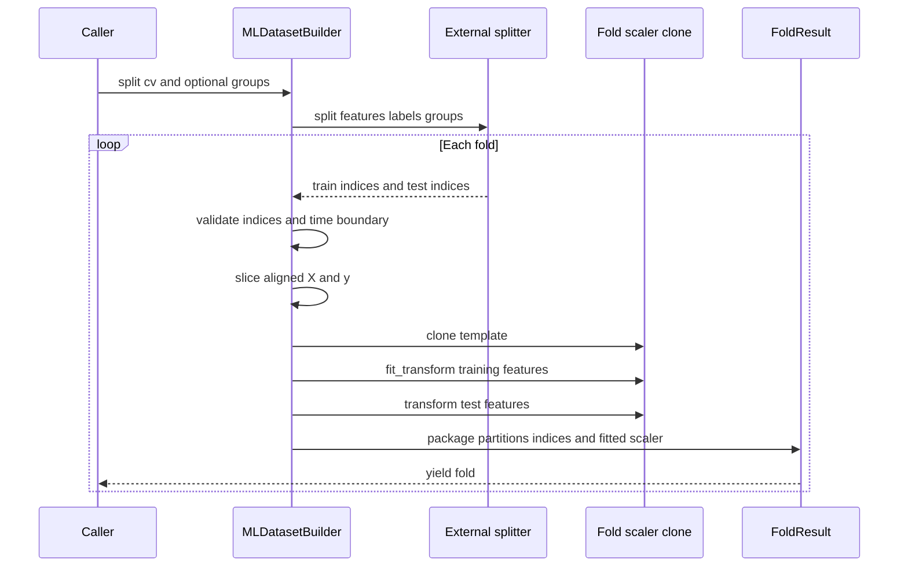

# Leakage-Safe Dataset and Preprocessing Pipeline

`MLDatasetBuilder` is the boundary between prepared research data and model fitting. It owns row alignment, split validation, train-only scaler fitting, and fold packaging; it does **not** compute features, labels, or choose a cross-validation policy. Upstream code must first produce causal feature columns and labels, align them row-for-row, remove unusable rows, and pass the resulting `pl.DataFrame`, `pl.Series`, and optional date series into the builder.

The end-to-end example makes that ownership explicit: it computes features, creates triple-barrier labels, excludes market and label-metadata columns from the feature set, drops rows with null selected features, and then takes features, `label`, and `timestamp` from the same filtered frame. See [`examples/complete_workflow_example.py`](../../examples/complete_workflow_example.py). For how those inputs are produced, see [Feature Computation](feature-computation.md) and [Labeling Runtime](labeling-runtime.md).

## Data contract and alignment

Construction is positional. `MLDatasetBuilder(features, labels, dates)` requires features and labels to have equal lengths; dates, when supplied, must have the same length too. A label `pl.DataFrame` is reduced to its first column. The builder does not join on timestamps or entity identifiers, infer alignment, drop null feature rows, or sort input. Consequently, filtering only one of the three inputs before construction can silently preserve equal lengths while destroying semantic alignment; derive all three from one already-filtered frame.

Feature selection is likewise an upstream operation. Despite an old module-summary reference to `set_features`, the class has no such method: pass `frame.select(feature_columns)` to the constructor. A scaler's `columns` option is narrower—it chooses which existing columns to transform and leaves the others unchanged; it is not dataset feature selection. With `columns=None`, scalers fit all numeric columns and preserve nonnumeric columns.

If dates are present, construction additionally requires:

- a Polars `Date` or `Datetime` series;
- no null timestamps; and
- nondecreasing sort order, with equal timestamps allowed.

These checks make row order an explicit temporal contract. Dates are retained on the builder for validation but are not inserted into `X_train` or `X_test`. Returned original row positions (`train_indices` and `test_indices`) are the stable route back to dates or other side metadata. The constructor and date checks are implemented in [`src/ml4t/engineer/dataset.py`](../../src/ml4t/engineer/dataset.py).

## Split paths

### Chronological train/test split

`train_test_split(train_size=0.8, shuffle=False)` validates that `train_size` is finite and strictly between zero and one and that both partitions remain nonempty. Without dates, it splits by row position, or by a reproducible NumPy permutation when `shuffle=True` and `random_state` is supplied.

With dates, shuffling is prohibited. The requested row boundary is moved to a timestamp-group boundary so that all rows sharing a timestamp stay in the same partition. The implementation prefers the latest timestamp change at or before the requested row; if the first group extends beyond that row, it moves forward to the first available change. A dataset containing only one distinct timestamp cannot be split safely and raises an error. This behavior is particularly important for panels where multiple assets share each decision timestamp.

This path fits the builder's configured scaler instance directly on training rows, transforms training rows, and then transforms test rows with the same fitted state. Reusing the builder for another manual split therefore refits and overwrites that scaler's state.

### External cross-validation

`split(cv, groups=None)` is an integration boundary, not a splitter implementation. The supplied object need only provide the sklearn-shaped `split(X, y=None, groups=None)` method and yield `(train_indices, test_indices)` pairs. The builder passes its Polars feature frame and label series as `X` and `y`; optional groups are length-checked and converted to NumPy. An external implementation must therefore accept these inputs and own fold policy such as walk-forward windows, purging, embargo, or grouping. The protocol is compatible in shape with ML4T Diagnostic and sklearn-style splitters, but compatibility still depends on the concrete splitter accepting Polars inputs.

The builder treats yielded indices as untrusted. For every fold it requires each partition to be a nonempty, one-dimensional integer array, rejects booleans, duplicates, and out-of-bounds positions, and then rejects overlap between train and test. If dates exist, it also requires `max(training dates) < min(test dates)`. That strict inequality both prevents temporally reversed folds and prevents an equal timestamp from appearing across partitions. Unlike the manual split, the builder does not repair an external splitter's boundary; the splitter must emit a valid boundary or the fold fails before preprocessing.

Groups do not relax temporal validation. A random or ordinary K-fold splitter can be structurally compatible yet still fail the strict date boundary. Choose a time-aware splitter when dates are attached.

## Per-fold preprocessing lifecycle

The configured scaler is a template for cross-validation. For each validated fold, `split()` calls `clone()`, fits that fresh clone on raw training rows, and applies the fitted clone to both training and test rows. `BaseScaler.clone()` shallow-copies configuration and deliberately clears fitted columns, statistics, and `is_fitted`; even if the template was previously fitted, no learned state crosses into a fold. Each `FoldResult` owns its fitted clone, making fold statistics inspectable and ensuring later folds cannot mutate earlier results.

*Each fold validates and slices aligned rows, learns preprocessing only from training features, and reuses that fold-specific state for both partitions.*

Labels are only gathered by index; they are never scaled. With no scaler configured, both split paths return the raw feature partitions and `FoldResult.scaler` is `None`.

## Scalers, configuration, and fitted state

[`src/ml4t/engineer/preprocessing.py`](../../src/ml4t/engineer/preprocessing.py) supplies three Polars-native `BaseScaler` implementations:

| Scaler | Learned training state | Transformation |
| --- | --- | --- |
| `StandardScaler` | mean and sample standard deviation by default | optional centering and variance scaling |
| `MinMaxScaler` | minimum and range | maps the training range to `feature_range`; test values may fall outside it |
| `RobustScaler` | median and configured interquantile range | optional robust centering and scaling |

All expose sklearn-like `fit`, `transform`, and `fit_transform`. Transforming, reading statistics, or serializing before fitting raises `NotFittedError`. Transform data must contain every fitted column. Nulls are excluded from learned statistics and propagate through transformations, while NaN and infinity are rejected during both fit and transform. Constant or all-null numeric columns use finite fallback denominators rather than dividing by zero.

`PreprocessingConfig` is the serializable configuration layer. It selects `standard`, `minmax`, `robust`, or no scaler, carries scaler-specific options and a transform-column list, and creates a new scaler through `create_scaler()`. `MLDatasetBuilder.set_scaler()` accepts such a config, a `BaseScaler`, or `None`; `create_dataset_builder()` additionally accepts the strings `"standard"`, `"minmax"`, and `"robust"`, and defaults to standard scaling. Configuration lives in [`src/ml4t/engineer/config/preprocessing_config.py`](../../src/ml4t/engineer/config/preprocessing_config.py).

A fitted scaler can be persisted with `to_dict()` and reconstructed by the matching class's `from_dict()`. The payload includes schema version, class, constructor configuration, fitted columns, and learned statistics. Loading fails closed on missing fields, schema or class mismatch, malformed configuration, or statistics that do not match fitted columns.

### Recommendation-driven pipeline is a separate boundary

`PreprocessingPipeline` applies per-feature diagnostic recommendations for `none`, `log`, `sqrt`, `standardize`, `normalize`, `winsorize`, or `diff`, subject to a confidence threshold. It learns all required offsets, moments, ranges, cutoffs, and the last training value during `fit`; notably, the first test `diff` is measured from the last fitted training value. It validates recommendation names and confidence, fitted feature presence, numeric/finite fitting values, and serialized state.

This pipeline follows the same fit-on-train, transform-test discipline, but it is **not** a `BaseScaler` and cannot be passed to `MLDatasetBuilder.set_scaler()`. Use it explicitly around already-created partitions, or add an adapter only if its clone and fitted-state semantics are preserved. Do not fit it on the full dataset before splitting.

## Fold results and interoperability

Each `FoldResult` contains Polars `X_train`, `X_test`, `y_train`, and `y_test`, original integer positions, a zero-based fold number, and the fitted fold scaler. `FoldResult.to_numpy()` returns those four partitions in that order for model libraries expecting NumPy.

At builder level, `to_numpy()` returns only `(features, labels)` and `to_pandas()` returns their raw full-dataset equivalents. Neither method applies scaling or performs a split, so they are unsuitable as shortcuts when leakage-safe preprocessing is required. Use `split()` or `train_test_split()` first. `get_feature_percentiles(train_indices)` and `compute_label_percentiles(train_indices)` similarly make the training subset explicit so cutoffs can later be applied without deriving thresholds from test data.

## Failure modes and safe change rules

- **Misaligned data:** construct features, labels, and dates from one filtered table; equal length alone cannot prove semantic alignment.
- **Unsafe temporal input:** reject null, unsorted, or non-temporal dates rather than sorting inside the builder, because an internal sort would also need to reorder labels and all side metadata.
- **Panel timestamp leakage:** preserve timestamp groups. Manual splitting adjusts the boundary; external CV must do so itself and is checked with a strict temporal inequality.
- **Invalid splitter output:** do not bypass index validation. It protects both Polars positional slicing and the train/test separation assumption.
- **Shared fitted state:** CV relies on `clone()` returning an unfitted instance. A new scaler implementation must reset every learned field in its clone.
- **Accidental full-data fitting:** raw conversion methods and recommendation pipelines do not acquire split semantics automatically.
- **Non-finite model inputs:** scalers permit null propagation but reject NaN and infinity. Null handling or imputation must be an explicit upstream or train-fitted step.

Feature artifacts may be persisted before this boundary; see [Offline Feature Store](../operations/offline-feature-store.md). Regression coverage and repository-wide validation expectations are summarized in [Quality Gates](../testing/quality-gates.md).

## Focused tests

The most important executable contracts are:

- [`tests/test_dataset.py`](../../tests/test_dataset.py): aligned lengths, date type/null/order checks, equal-timestamp manual boundaries, invalid external indices, strict fold chronology, per-fold scaler identity and train-only statistics, and NumPy shapes;
- [`tests/test_preprocessing.py`](../../tests/test_preprocessing.py): fitted-state errors, selected-column behavior, train-statistic reuse, finite-value validation, serialization, recommendation transforms, and training-boundary differencing;
- [`tests/test_feature_panel_preparation.py`](../../tests/test_feature_panel_preparation.py): causal panel preparation and non-revision of prior features when future observations are appended;
- [`tests/test_lookahead_bias_fixes.py`](../../tests/test_lookahead_bias_fixes.py): representative rolling-feature checks showing that appending future rows does not revise earlier feature values.
