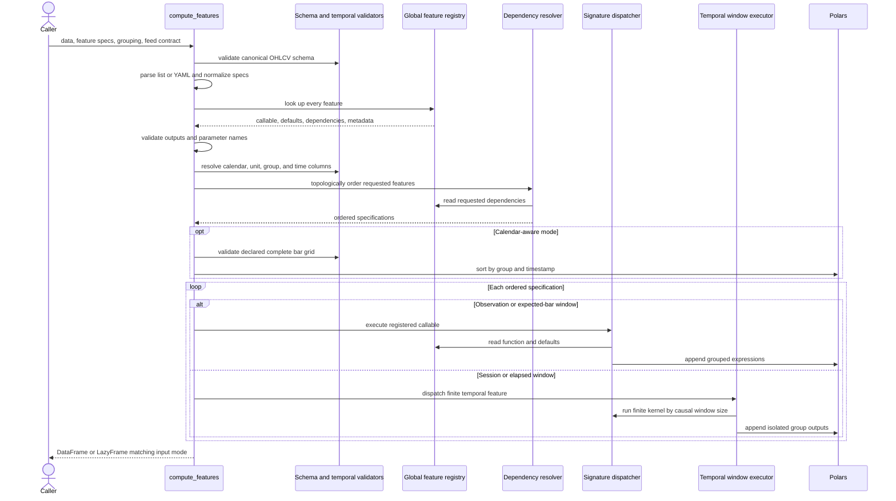

# Registry-Driven Feature Computation

`compute_features` is the configuration-driven bridge between canonical OHLCV data and the library's registered Polars feature expressions. It does not implement indicators itself. Instead, it normalizes requests, validates the entire request and temporal contract, reads function and dependency metadata from a process-global registry, and appends the resulting expressions in a safe order.

This layer is related to, but separate from, [dataset preprocessing](dataset-preprocessing.md): feature computation creates columns over a declared history, while preprocessing owns later fit/transform behavior. The temporal rules summarized here are part of the broader [temporal data contracts](../concepts/temporal-data-contracts.md).

## Runtime flow



*The call validates all specifications and temporal structure before choosing ordinary expression dispatch or finite temporal-window execution.*

## 1. Inputs and normalized feature specifications

The public entry point accepts a `pl.DataFrame` or `pl.LazyFrame` and one of three feature-configuration forms:

```python
["rsi", "macd"]

[
    {"name": "sma", "params": {"period": 20}, "output": "sma_20"},
    {"name": "sma", "params": {"period": 50}, "output": "sma_50"},
]

Path("features.yaml")
```

A string is interpreted as a YAML path, not as one feature name. YAML may be either a top-level list or a mapping with a `features` list. PyYAML is optional until a path is supplied; a missing dependency or file fails immediately. Every item becomes the internal shape `{"name": str, "params": dict, "output": str}`. A bare feature name defaults `params` to `{}` and `output` to the feature name. Mapping entries permit only `name`, `params`, and `output`, with non-empty string names and outputs.

The explicit `output` is important when the same feature is configured more than once. Repeating `sma` without distinct outputs is rejected rather than silently replacing or dropping a result.

## 2. Validation before execution

Validation is intentionally front-loaded. The major phases are:

1. **OHLCV schema:** `open`, `high`, `low`, `close`, and `volume` must exist and be numeric. Eager frames also receive integrity checks such as non-negative prices and `high >= low`. A time or asset column is not mandatory at this first step.
2. **Whole request:** every registered name is resolved, every output is unique and does not collide with an input column, and every supplied parameter exists in the callable's signature after known data-column parameters are excluded. Consequently, a bad later specification prevents an earlier valid feature from running.
3. **Feed contract:** feature computation requires canonical OHLCV names and `price_col='close'`. `FeedSpec` may also provide the entity and timestamp columns. Explicit call arguments take precedence where supplied.
4. **Window contract:** `calendar=None` permits only `observation`; calendar-aware calls reject `observation` and default to `expected_bar`. `session` and `elapsed` requests are validated for feature support and period type before execution. An elapsed window cannot use `session_label` semantics.
5. **Ordering columns:** grouping and timestamp columns are selected and checked for existence, temporal dtype, and nulls.
6. **Dependency and grid checks:** requested features are topologically ordered. Calendar-aware execution then validates the declared daily-session or intraday-bar grid, including each group's missing, duplicate, or off-grid observations, before any feature loop begins.

The temporal contract is explicit rather than gap-inferred. In calendar-aware mode, `feed_spec` must contain the declarations required by the daily or intraday grid validator; supplied `returns` are additionally checked so a finite return is not adjacent to a missing price. The validated data is sorted by group columns and timestamp. In observation-row mode, there is no schedule check and no sort: input order is the computational order.

An empty feature list is a special case. With `calendar=None`, the original object is returned immediately. In calendar-aware mode, the call still resolves ordering, validates the grid, and returns the sorted data; this supports validating prices before deriving returns.

## 3. Registry ownership and import lifecycle

`FeatureRegistry` is a dictionary-backed process-global registry keyed by unique feature name. `@feature` registration happens as feature modules are imported; importing `ml4t.engineer` imports the `features` package, whose category imports trigger those decorators. Duplicate names fail registration.

The decorator returns the original function unchanged—there is no runtime wrapper—but records `FeatureMetadata` containing the callable, category, description, defaults, dependencies, input/output classifications, discoverability fields, and a lookback calculator. Registration verifies that declared defaults name real function parameters and agree with function defaults. Built-in features use authoritative lookback calculators from `core.lookbacks`; third-party registrations must provide a fixed, parameter-named, or callable lookback, and its default result must be a non-negative integer.

Although `input_type` is valuable catalog metadata, `compute_features` dispatch is signature-driven. Required callable parameters named in `COLUMN_ARG_MAP` become canonical column-name arguments—for example, `price` maps to `close` and `returns` maps to `returns`. The API's outer schema remains canonical OHLCV, while any extra column actually referenced by a kernel must be present when Polars resolves or executes the expression.

## 4. Dependency ordering

The resolver applies a stable Kahn-style topological pass over the **requested specifications**. For each feature, it intersects registry `dependencies` with requested feature names; a feature becomes ready after those requested dependencies have completed. Independent ready items retain request order, and a cycle among requested features raises before execution.

Dependencies are ordering metadata, not an installation plan: the resolver does **not** automatically add a dependency omitted by the caller. A dependency that a callable needs as an input must therefore either be requested or already exist in the data, according to that callable's implementation. This distinction matters when introducing metadata dependencies: changing the list can reorder combined calls and can create a cycle, but it does not create an implicit output request.

## 5. Ordinary dispatch and group isolation

For ordinary `observation` and `expected_bar` execution, `_execute_feature` inspects the registered function signature:

- registry defaults are merged with request parameters, with request values winning;
- required known column arguments are passed positionally as column-name strings;
- `implementation` is always passed as a keyword when configured;
- optional column-like parameters retain their function defaults;
- a required non-column parameter with no default produces a targeted error;
- a `TypeError` raised while calling the feature factory is wrapped with signature and attempted-call diagnostics.

Registered functions return Polars expressions, not computed Series. Before appending them, dispatch applies `.over(group_cols)` to each expression. This makes rolling, lagged, and recursive expression state independent for every entity while preserving the frame's row order in observation mode. If `group_col` is omitted, the first recognized column among `asset_id`, `symbol`, `ticker`, `product`, and `asset` is selected. Passing `group_col=[]` cannot disable isolation when one of those recognized asset columns exists. Explicit multi-column groups are supported.

Calendar-aware mode sorts by group and timestamp first. Row mode deliberately does not reorder: even if timestamps are descending or interleaved, each group's observations are processed in their incoming order. This is why `calendar=None` is an explicit assertion about observation order, not a shortcut for calendar inference.

## 6. Temporal-window branch

`window_unit='session'` and `'elapsed'` use a separate executor and currently support only the finite-window kernels `sma`, `stddev`, and `realized_volatility`. Recursive or multi-window indicators such as `ema` and `rsi` are rejected instead of being silently converted into row counts.

A session period is a positive integer count of scheduled exchange sessions. An elapsed period is a positive fixed duration and operates over physical UTC time with an open-left bound. Neither branch resamples data. Instead, the executor:

1. derives a causal row-window size at every original bar from schedule ordinals or timestamps;
2. partitions eager data by entity so no history crosses groups;
3. runs the existing finite row kernel once for each distinct eligible window size and scatters values back to the matching positions;
4. leaves incomplete warm-up windows null.

For a lazy input, the same operation is wrapped in `map_batches` with pushdowns disabled so a downstream filter, projection, or slice cannot remove warm-up history before computation. The schema is established by executing the kernel against an empty input at its minimum supported period. Session and elapsed execution therefore preserve typed empty outputs as well as causal, per-group behavior.

## 7. Output naming and return-type preservation

Output names are determined from the normalized `output` base:

| Feature return | Appended names |
|---|---|
| one `pl.Expr` | `output` |
| `dict[str, pl.Expr]` | `output_key` |
| tuple or list of expressions | `output_0`, `output_1`, ... |

Non-expression members of a mixed mapping or sequence are ignored, but a container with no expression values is an error. Any derived-name collision with an existing column, or duplicate names produced by one feature, is rejected at append time. A completely unsupported return type is a `TypeError`.

Both ordinary and temporal paths preserve the caller's execution mode: eager input returns `pl.DataFrame`; lazy input returns `pl.LazyFrame`. Ordinary features add lazy expressions with `with_columns`. Temporal features remain lazy through `map_batches` and only materialize when the caller collects. Some contract checks intentionally inspect or collect narrow schema/group/time projections before returning a lazy plan, so “lazy return” does not mean validation itself is entirely deferred.

## 8. Discovery and the standalone-helper boundary

`FeatureCatalog` wraps the same registry used by execution. It can list features by category, normalization status, TA-Lib compatibility, tags, input/output type, or dependency presence; search names and descriptive metadata; and describe defaults, references, value range, dependencies, and computed default lookback. The package-level discovery proxy therefore reflects what `compute_features` can find by name.

Not every function under `features/` belongs to that execution model. Panel-aware cross-asset operations, paired regressions, event counts, selection/preparation utilities, input conversion, and some composite or fractional-differencing utilities are standalone helpers. They may require whole frames, paired inputs, eligibility facts, or specialized missing-data policy that cannot be represented as a registered single-history expression. They must be called through their own APIs and will not appear in `FeatureCatalog` or resolve by name in `compute_features`. The architectural boundary is registration, not directory location.

## Extension and change checklist

When adding or changing a registry-backed feature:

1. Keep the callable expression-oriented and use parameter names covered by `COLUMN_ARG_MAP`, or extend dispatch deliberately.
2. Register it with a unique name and complete metadata; ensure metadata defaults exactly match signature defaults.
3. Add or update the authoritative built-in lookback calculation, or provide a valid lookback for a third-party feature.
4. Declare dependencies only for ordering relationships and test combined requests explicitly.
5. Confirm grouped eager and lazy execution match independent per-asset runs.
6. If temporal units are intended, extend the finite-feature support table and test session, elapsed, warm-up, empty, panel, and lazy pushdown behavior; do not reinterpret a recursive kernel.
7. Verify single and multi-output naming cannot overwrite source or prior feature columns.

See [Adding or Changing Features](../workflows/adding-or-changing-features.md) for the contributor workflow and [Quality Gates](../testing/quality-gates.md) for broader test expectations.

## Source map and focused tests

- [`api.py`](../../src/ml4t/engineer/api.py) owns parsing, validation order, dependency resolution, dispatch, grouping, and output append rules.
- [`decorators.py`](../../src/ml4t/engineer/core/decorators.py), [`registry.py`](../../src/ml4t/engineer/core/registry.py), and [`lookbacks.py`](../../src/ml4t/engineer/core/lookbacks.py) own registration-time metadata and warm-up contracts.
- [`bar_grid.py`](../../src/ml4t/engineer/core/bar_grid.py) and [`temporal_windows.py`](../../src/ml4t/engineer/core/temporal_windows.py) own calendar-grid and finite temporal-window behavior.
- [`catalog.py`](../../src/ml4t/engineer/discovery/catalog.py) provides registry-backed discovery.
- [`test_api.py`](../../tests/test_api.py) covers formats, fail-fast validation, dispatch, grouping, naming, dependency cycles, and eager/lazy equivalence.
- [`test_api_temporal_windows.py`](../../tests/test_api_temporal_windows.py) covers causal session/elapsed behavior, grid failures, panels, lazy optimization barriers, and unsupported indicators.
- [`test_all_features_integration.py`](../../tests/test_all_features_integration.py) exercises every registered feature individually, together, and against independent per-asset execution.
