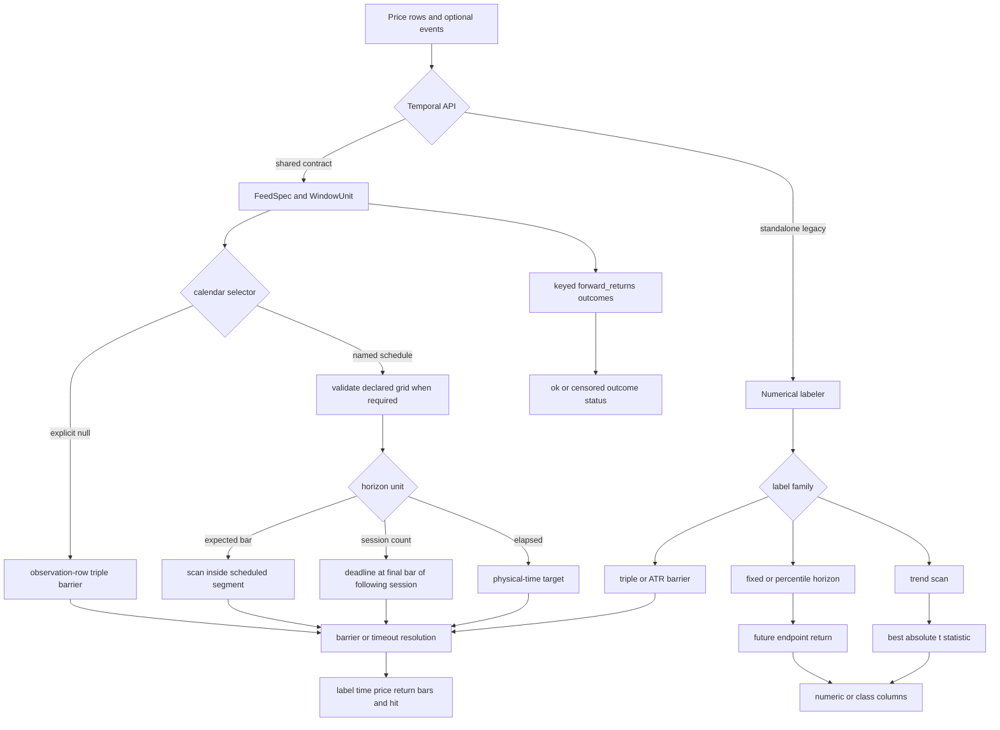

# Labeling Runtime and Outcome Semantics

The labeling package turns future price paths into supervised targets, then optionally describes how much labels overlap and how they should be sampled. It contains two deliberately different temporal worlds:

1. **Shared-contract, calendar-aware outcomes** use `FeedSpec`, `WindowUnit`, an authoritative schedule, and grid validation where required. The principal APIs are `calendar_aware_labels` for triple-barrier outcomes and `forward_returns` for keyed realized returns.
2. **Standalone numerical labelers** preserve legacy row and duration definitions. These include `fixed_time_horizon_labels`, `rolling_percentile_binary_labels`, `triple_barrier_labels`, `atr_triple_barrier_labels`, and `trend_scanning_labels`.

A timestamp argument can sort rows, calculate a duration, or support an as-of lookup. **It does not, by itself, opt a standalone function into the shared temporal contract.** Use `calendar_aware_labels` or `forward_returns` with the required declarations when session-count, expected-bar completeness, or schedule boundaries matter. This boundary complements the repository-wide [Temporal Data Contracts](../concepts/temporal-data-contracts.md) and the downstream [Dataset Preprocessing](dataset-preprocessing.md) contract.

## Runtime map

*Calendar-aware paths interpret declared clocks and schedules; standalone paths retain their own observation-row or elapsed-duration mathematics before resolving a barrier, endpoint, or trend outcome.*

## Temporal vocabulary and invariants

These terms are not interchangeable:

| Term | Meaning in this runtime | Tail or coverage behavior |
|---|---|---|
| **Observation row** | The next chronological row within an asset or group. Under `calendar_aware_labels(..., calendar=None)`, even timestamped input stays in original observation order rather than being timestamp-sorted. | The barrier engine clips a deadline to the final observed row and emits a time-barrier result. |
| **Expected bar** | A bar on a declared schedule and frequency grid, not merely the next row that happened to arrive. | `calendar_aware_labels` validates the declared grid first; a missing scheduled bar is an error, not a shorter horizon. |
| **Session count** | The final available bar of the Nth following scheduled session. Lunch and overnight breaks do not create extra sessions. | The deadline is clipped to observed coverage end, so an event beyond available coverage is represented as a censored time exit rather than an independently identified full-horizon timeout. |
| **Elapsed duration** | A fixed physical duration from an instant, resolved using the declared timezone and physical elapsed arithmetic. | Session-label dates are identifiers, not instants, and are rejected for elapsed horizons. Standalone duration APIs instead use their documented as-of or duration-to-row conversion. |
| **Timeout** | No horizontal barrier was touched before the chosen vertical deadline; triple-barrier output uses `label=0` and `barrier_hit="time"`. | In the barrier kernel, an ordinary vertical timeout and a deadline clipped at the final available row share the same output class. Consumers must retain external coverage knowledge if they need to distinguish them. |
| **Coverage censoring** | The requested outcome extends beyond supplied observations or scheduled sessions. | `forward_returns` exposes this explicitly as `outcome_status="insufficient_tail"`; `tail_policy` keeps it as null, drops it, or raises. Triple-barrier labels do not expose a separate censoring status. |

For a named calendar, `calendar_aware_labels` resolves the explicit argument first, then a calendar explicitly declared on `LabelingConfig`, then feed metadata, with the shared resolver's NYSE default. Declaration presence matters: an omitted calendar inherits, while explicit `None` disables schedule loading and permits only observation-count mode. Serialization preserves that distinction. A named `FeedSpec` must declare timestamp semantics; naive instant timestamps also require a timezone. Expected-bar and session windows, and daily session-label feeds, require an authoritative named schedule and pass through declared-grid validation before labeling. Legacy `calendar="auto"` only splits on observed gaps and cannot serve as an authoritative `FeedSpec` calendar.

Schedule segmentation is also outcome semantics. Intraday observation, expected-bar, and elapsed compatibility paths do not scan across a scheduled break. Session windows do cross breaks and select a session endpoint. Right-labeled bars may legitimately end exactly at a break boundary even though an event timestamp at that same instant would be off-session. For instant inputs, `label_duration` is elapsed physical time; for row mode and session-label identifiers it is null.

## Outcome families

### Fixed-horizon returns and directions

`fixed_time_horizon_labels` is the compact standalone API:

- An integer `horizon` shifts by that many rows per group. It appends `label_return_{horizon}p`, `label_log_return_{horizon}p`, or `label_direction_{horizon}p`.
- A duration string finds the first available price at or after the target time, optionally constrained by `tolerance`, and uses a duration suffix such as `label_return_15m`.
- Return labels contain simple or logarithmic returns. Binary labels use `+1`, `-1`, and `0` around a configurable nonnegative threshold; unavailable endpoints remain null.
- Input is sorted by group and timestamp when a timestamp is resolved, and insufficient tail rows are null.

This API's integer horizon means observed rows. Its duration horizon is an as-of lookup over supplied timestamps. Neither meaning implies expected bars or sessions merely because `timestamp_col` is present.

`forward_returns` is the stricter shared-contract alternative. It emits one long row per exact entry key and named horizon, supports `observation`, `expected_bar`, `session`, and `elapsed` units, and records `requested_exit_time`, `exit_time`, `reference_time`, `forward_return`, provenance flags, and `outcome_status`. `index_mode="per_asset"` counts each asset's observations; `common_grid` counts the supplied union clock without filling absent quotes. `endpoint_method="cumulative"` compares entry to exit, while `"exit_bar"` compares the exit with its preceding reference row. Missing endpoints and prices remain distinguishable from an insufficient tail, and `outcome_available_at` is populated only when both required availability timestamps are known.

### Rolling percentile labels

`rolling_percentile_binary_labels` first computes a forward return, then compares it with a rolling historical quantile. A long label is `1` when return is at least the threshold; a short label is `1` when return is at most it, otherwise `0`. It appends:

- `forward_return_{horizon}`;
- `threshold_p{percentile}_h{horizon}`;
- `label_{direction}_p{percentile}_h{horizon}`.

The important anti-leakage rule is that a return enters the quantile history only at its endpoint row or endpoint timestamp. Outcomes whose horizons have not ended are excluded. Thresholds stay null until `min_samples` realized outcomes exist, and labels are consequently null there and at an unavailable forward endpoint. Integer horizons count rows, optional `session_col` prevents those row shifts from crossing the supplied session grouping, and duration horizons use an as-of endpoint; this remains a standalone numerical contract, not schedule validation. `rolling_percentile_multi_labels` repeats this operation for the Cartesian product of unique horizons and percentiles.

### Triple barrier

`triple_barrier_labels` scans each event forward until the first profit target, stop, or vertical deadline. If `event_time` exists, only non-null event rows are labeled; otherwise every row is an event. Panel groups are isolated and sorted chronologically. The result adds:

- `label`: `+1` profit target, `-1` stop, `0` time exit;
- `barrier_hit`: `"upper"`, `"lower"`, or `"time"`;
- `label_time`, `label_price`, `label_return`;
- `label_bars` and `label_duration`;
- optional `label_uniqueness` and `sample_weight`.

With only close prices, the close acts as both high and low. With OHLC, the engine checks intrabar extrema; if one bar touches both target and stop, the stop wins because OHLC cannot reveal ordering. Supplying `open_col` additionally executes a gap beyond a barrier at the open. A trailing stop updated from a bar becomes active on the following bar for the same ordering reason.

An integer or integral column holding period is an observation-row count. A standalone duration holding period is converted per event into a row count from supplied timestamps, then the same numerical kernel runs. The scan includes the vertical-barrier bar and clips at the end of data. Consequently the final rows receive `label=0` with their best available exit, rather than null or a distinct censoring marker.

`calendar_aware_labels` wraps this same barrier engine but owns schedule interpretation. Explicit `calendar=None` preserves each asset's observation order and the global input row order; it does not even require a timestamp. Named schedules sort and segment rows, reject off-session timestamps, and apply the `WindowUnit` rules described above. The wrapper accepts only `LabelingConfig.method="triple_barrier"`.

### ATR barriers

`atr_triple_barrier_labels` computes Wilder ATR independently by asset, creates price-unit `upper_barrier_distance` and `lower_barrier_distance`, normalizes them to fractional distances from the entry price, and delegates to `triple_barrier_labels`. Rows without a finite positive ATR are not selected as events. The output therefore combines ATR diagnostics and the ordinary triple-barrier schema.

ATR requires `high`, `low`, and `close`, plus a resolvable timestamp. Multiples and period must be finite positive values. If no maximum holding period is supplied, the implementation uses the input length; this can make scanning quadratic and warns above 5,000 rows. ATR labeling remains standalone: its timestamp and grouping support do not add expected-bar or session semantics.

### Trend scanning

`trend_scanning_labels` scans forward windows from `min_window` through `max_window` in `step` increments, fits a linear trend for each, and chooses the window with maximum absolute slope t-statistic. It returns `label`, `t_value`, and `optimal_window`. Direction is `+1` or `-1` only when the selected statistic reaches `t_value_threshold`; otherwise the diagnostic statistic and window remain while the label is null. Constant or unavailable windows remain null, while a perfect nonconstant linear fit is represented by the largest finite signed float. Windows are row counts within a chronologically sorted group.

### Meta-labeling and sizing

`meta_labels` does not resolve time itself. It consumes an already aligned primary signal and forward-return column and emits `meta_label=1` when `sign(signal) * return > threshold`, `0` otherwise, and null when signal or return is unavailable or signal is zero. The caller therefore owns the temporal alignment and availability of the return target.

`compute_bet_size` transforms a meta-model probability through linear, sigmoid, or discrete sizing. `apply_meta_model` validates probabilities in `[0, 1]`, multiplies the primary signal's sign by the nonnegative part of that size, and never lets a low confidence value reverse the primary direction.

## Overlap, uniqueness, and bootstrap

Barrier events often overlap, so raw row count overstates independent evidence. `build_concurrency` counts active labels on the inclusive interval from event index through label index. `calculate_label_uniqueness` averages `1 / concurrency` over each such interval, producing values in `[0, 1]`. `calculate_sample_weights` supports uniqueness times absolute return, uniqueness only, absolute return only, or equal weights, then normalizes weights to sum to the sample count; an all-zero weighting signal falls back to equal weights.

`sequential_bootstrap` is a sampler, not a label generator. At every draw it recomputes each candidate's expected marginal uniqueness against intervals already selected and samples proportionally to that quantity. It supports deterministic seeds or a NumPy `Generator`, with or without replacement. Without replacement, requesting more draws than available candidates fails rather than silently recycling events.

These utilities consume **integer interval indices**. If labels came from multiple assets or independently segmented clocks, callers must not combine unrelated index spaces as though they shared one concurrency timeline.

## Configuration and extension boundaries

`LabelingConfig` is the serializable discriminator for `triple_barrier`, `atr_barrier`, `fixed_horizon`, `trend_scanning`, and `percentile` settings. Barrier distances are positive magnitudes; `side` determines direction. Factories validate positive periods, finite numerical settings, legal sides, and trend window ordering. Explicit arguments that conflict with the method-specific config are rejected in fixed-horizon and trend APIs, while the barrier API rejects a config with the wrong method.

For safe extensions:

- Add new shared temporal behavior at the `FeedSpec`/`WindowUnit` boundary, not by teaching a legacy timestamp parameter to imply a calendar.
- Preserve separate states for omitted calendar and explicit `None`; they have different inheritance and runtime meanings.
- Keep group isolation, stable output schemas for groups with no selected events, and input-column collision avoidance.
- If a new barrier outcome distinguishes timeout from coverage censoring, add an explicit status field rather than changing the established meaning of `label=0`.
- Treat output labels as future-derived data. Availability must be carried into feature/dataset assembly; see [Feature Computation](feature-computation.md).

## Failure boundaries and focused tests

The runtime fails early for missing or nonnumeric prices, nonfinite barrier values, inconsistent OHLC (`low <= open/close <= high`), invalid sides or holding periods, wrong config methods, and malformed duration declarations. Calendar-aware paths additionally reject undeclared timestamp semantics, timezone ambiguity, off-session rows, missing scheduled bars, elapsed horizons over session-label dates, and schedule-dependent units with no authoritative calendar. `forward_returns` rejects duplicate or null keys, conflicting feed declarations, invalid prices according to policy, and unmatched explicit entries.

High-value regression coverage includes:

- [`tests/test_labeling_time_contract.py`](../../tests/test_labeling_time_contract.py): explicit row mode, declaration precedence and serialization, expected-grid outage rejection, break boundaries, timezone semantics, and the deliberate standalone/calendar boundary.
- [`tests/labeling/test_time_horizons.py`](../../tests/labeling/test_time_horizons.py): integer versus elapsed standalone horizons, irregular grouped as-of endpoints, duration parsing, tolerance, and duration-to-bar barrier behavior.
- [`tests/labeling/test_release_critical_paths.py`](../../tests/labeling/test_release_critical_paths.py): OHLC and gap resolution, conservative dual touches, ATR validation and complexity warning, percentile validation, uniqueness normalization, meta-label validation, and calendar protocol failures.

Run these focused suites when changing temporal interpretation or output schemas, then use the broader gates described in [Quality Gates](../testing/quality-gates.md).
