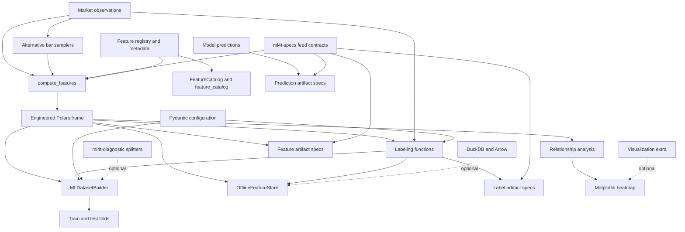

# System Map and Public Surfaces

`ml4t-engineer` is a Polars-first library for turning market observations into engineered features, labels, alternative bars, and leakage-aware model datasets. Its center of gravity is an in-process pipeline rather than a service: callers supply frames, select computations, and receive frames or series. The package needs no credentials or external service for its core workflow; `ml4t-specs` supplies shared feed and artifact contracts, while storage, calendars, plotting, TA-Lib validation, and downstream diagnostics are integration boundaries.

## Runtime map



*Major data flow from market observations through computation, labeling, dataset preparation, persistence, and analysis, with shared and optional external boundaries shown separately.*

The diagram is compositional, not a mandatory end-to-end runner. For example, artifact records do not automatically persist data, and labels can be produced directly from prices without first calling `compute_features()`.

## Primary workflows

### Feature computation and discovery

The strongest package-level entry point is:

```python
from ml4t.engineer import compute_features
```

`compute_features()` accepts a `polars.DataFrame` or `polars.LazyFrame` plus feature names, parameter dictionaries, or a YAML path. It validates the OHLCV shape, normalizes the request, resolves registered dependencies topologically, and appends outputs in execution order. Registry metadata determines the callable, default parameters, required input type, dependencies, and discoverability fields. Importing `ml4t.engineer.features` loads feature categories for their decorator-driven registration side effect. See [Feature Computation](feature-computation.md) for ordering, grouping, calendars, and temporal windows.

Temporal semantics are part of the computation contract rather than an afterthought. Explicit `calendar=None` means observation-row order and observation windows. Calendar-aware execution resolves a `FeedSpec`, validates the declared grid before running a feature, sorts by group and time, and only permits compatible expected-bar, session, or elapsed windows. Noncanonical OHLCV mappings and incompatible calendar/window combinations fail early.

Discovery reads the same global registry rather than maintaining a second catalog. The package root exports the `FeatureCatalog` class and the singleton-like proxy as `feature_catalog`:

```python
from ml4t.engineer import FeatureCatalog, feature_catalog

names = feature_catalog.list(category="momentum", normalized=True)
info = feature_catalog.describe("rsi")
```

Be careful with names: `from ml4t.engineer import features` imports the **feature submodule**, whereas `feature_catalog` is the root-level discovery object. Use `FeatureCatalog` when isolation around a supplied registry is useful.

### Label generation and alternative bars

Labeling is a direct submodule API:

```python
from ml4t.engineer.labeling import triple_barrier_labels, forward_returns
```

It includes path-dependent triple/ATR barriers, fixed-horizon and trend-scanning labels, rolling percentile labels, meta-label helpers, and uniqueness/sample-weight utilities. These outputs are supervised-learning targets and may intentionally inspect a declared forward horizon; they must not leak information before that horizon. Calendar-aware adapters are also available. The labeling package defines metadata wrappers for selected label methods for backward-compatible registry registration, but callers should normally use the labeling functions themselves. See [Labeling Runtime](labeling-runtime.md).

Alternative bars sit before feature and label computation when time bars are not the desired sampling unit:

```python
from ml4t.engineer.bars import VolumeBarSampler, TickImbalanceBarSampler
```

The `bars` package exposes tick, volume, dollar, imbalance, and run samplers. Vectorized implementations are the default aliases for standard samplers; classes suffixed `Original` preserve the earlier implementations. Fixed-threshold imbalance samplers are the production-oriented choices, while adaptive and bounded-window variants expose different state behavior. This is a documented direct-submodule surface, not a root re-export. See [Bar Sampling](bar-sampling.md).

### Leakage-aware datasets and preprocessing

The package root re-exports `MLDatasetBuilder`, `create_dataset_builder`, `FoldResult`, `DatasetInfo`, the scaler classes, `Preprocessor`, and `PreprocessingPipeline`. The builder aligns features and labels, optionally validates a sorted non-null `Date`/`Datetime` index, selects features, and drives either a simple split or a caller-supplied splitter.

Its central invariant is train-only fitting. For each cross-validation fold, it validates index shape, bounds, uniqueness, and train/test disjointness; with dates, training timestamps must strictly precede test timestamps. It clones the configured scaler per fold, fits that clone on training rows, and uses the fitted clone for both training and test transforms. A dated simple split cannot shuffle and moves its boundary so equal timestamps remain in one partition. See [Dataset and Preprocessing](dataset-preprocessing.md).

A splitter from `ml4t-diagnostic` or a compatible sklearn-style implementation is an optional caller-supplied collaborator, not an engine-owned dependency or split policy.

## Support surfaces and integration boundaries

| Surface | Recommended import | Architectural role | Stability signal |
|---|---|---|---|
| Main compute | `from ml4t.engineer import compute_features` | Registry-driven feature execution | Primary root API |
| Dataset/preprocessing | `from ml4t.engineer import MLDatasetBuilder, StandardScaler` | Leakage-aware model preparation | Primary root API |
| Discovery | `from ml4t.engineer import FeatureCatalog, feature_catalog` | Search and inspect registry metadata | Root public API |
| Labeling | `from ml4t.engineer.labeling import ...` | Build supervised targets and weights | Primary direct-submodule API |
| Alternative bars | `from ml4t.engineer.bars import ...` | Resample trades by activity or information | Primary direct-submodule API |
| Configuration | `from ml4t.engineer.config import LabelingConfig, PreprocessingConfig` | Reusable validated declarations and experiment serialization | Support API; not root-re-exported |
| Artifact contracts | `from ml4t.engineer.artifacts import FeatureSpec, LabelSpec, PredictionSpec` | Typed metadata for persisted pipeline products | Support API; not persistence itself |
| Relationships | `from ml4t.engineer.relationships import compute_correlation_matrix` | Exploratory correlation and multicollinearity analysis | Secondary root-imported submodule |
| Offline store | `from ml4t.engineer.store import OfflineFeatureStore` | Local DuckDB persistence and point-in-time joins | Secondary optional integration |
| Registry internals | `ml4t.engineer.core` | Registration, dispatch, schemas, grids, calendars | Extension/internal surface; prefer higher-level APIs |

Root importability is not a promise that every imported submodule has equal compatibility weight. The explicit package `__all__` is the best guide to root symbols: it includes the main compute, discovery, dataset, and preprocessing names plus selected submodules. It does **not** flatten every labeling function, bar sampler, configuration model, artifact type, relationship function, or store class into the root namespace. Import those from their owning submodule, and avoid reaching into implementation files when an `__init__.py` export exists.

`get_agent_docs()` is also root-exported, but it is navigation support: it discovers packaged `AGENTS.md` guides. It is not part of feature execution or data lifecycle.

## Configuration, artifacts, and persistence are separate concerns

Configuration models validate reusable intent: labeling parameters, preprocessing choices, dataframe contracts, and serializable experiment settings. `data_contract_from_market_data_spec()` adapts a shared `ml4t-specs.FeedSpec`-compatible mapping or object into the local `DataContractConfig`. Runtime feature computation also consumes `FeedSpec` directly for column and temporal declarations. These are contract bridges, not data loaders; `ml4t-data` is the adjacent library responsible for supplying validated market data.

Artifact classes are immutable typed records around shared `ml4t-specs` primitives. `FeatureSpec`, `LabelSpec`, and `PredictionSpec` pair storage and provenance metadata with domain-specific schemas and definitions. They describe such concerns as entity/time columns, feature lookbacks, label horizons, or prediction columns; they do not contain the actual frames and do not call the store.

`OfflineFeatureStore` is the optional operational persistence boundary. Importing its module tolerates missing DuckDB, but constructing the store raises `FeatureStoreError` with an installation hint when DuckDB is unavailable. A store owns a DuckDB connection until `close()` or context-manager exit and supports local save/load, table management, filtering, and point-in-time joins. Use the `store` extra for DuckDB and PyArrow. See [Offline Feature Store](../operations/offline-feature-store.md).

Relationship analysis is deliberately downstream and smaller in scope than `ml4t-diagnostic`. `compute_correlation_matrix()` accepts Polars or pandas frames and produces a Polars correlation matrix for Pearson, Spearman, or Kendall methods. `plot_correlation_heatmap()` imports Matplotlib only when called and fails with an installation hint if plotting support is absent; install the `viz` extra for that path.

## Extension and change boundaries

- **Add a registered feature** by using the registry/decorator path and keeping metadata—especially input type, dependencies, parameters, and first usable row—consistent with implementation. The computation engine and discovery catalog then see the same definition.
- **Add a label or sampler** in its owning domain and export it from that domain's `__init__.py`; do not assume root re-export is required.
- **Add configuration or artifact fields** at their contract boundary and preserve round-trip serialization and compatibility with `ml4t-specs`.
- **Keep optional imports lazy or guarded.** Base `import ml4t.engineer` must continue to work without DuckDB, market calendars, Matplotlib, or TA-Lib.
- **Preserve frame semantics.** A feature path that claims both eager and lazy support should not silently collect a `LazyFrame`, and grouped rolling/lagged operations must not cross asset boundaries.

Focused regression coverage lives in `tests/test_api.py` plus the calendar/grid/temporal API tests, `tests/test_dataset.py`, labeling tests under `tests/labeling/`, bar tests under `tests/bars/`, `tests/test_config_system.py`, `tests/test_artifacts.py`, and `tests/store/test_offline.py`. Changes at a boundary should exercise both the owning domain and its integration invariant—for example registry dependency order, future-horizon safety, fold-local scaler state, optional dependency failure, or artifact serialization—not merely import success.
