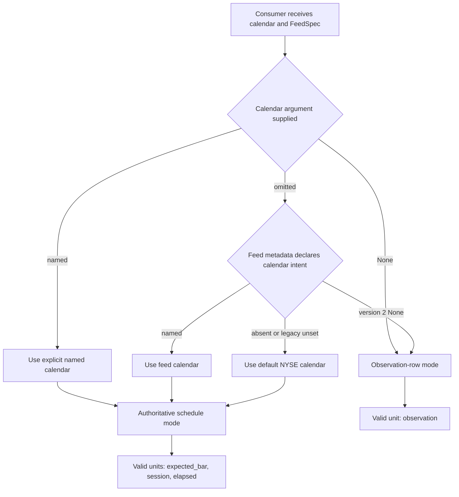

# Temporal and Market-Data Contracts

Temporal behavior is selected by a contract, not reconstructed from convenient patterns in the data. A `FeedSpec` declares column names, calendar intent, timestamp meaning, frequency, and bar-grid policy. Consumers then either validate against a named authoritative schedule or enter explicit observation-row mode. A gap is therefore not evidence of a market closure, and regular spacing is not enough to establish a bar grid.

This contract is shared by feature computation, calendar-aware labeling, and calendar helpers. It is the temporal foundation beneath [bar sampling](../architecture/bar-sampling.md), [feature computation](../architecture/feature-computation.md), [labeling runtime](../architecture/labeling-runtime.md), and an [offline feature store](../operations/offline-feature-store.md).

## Resolution: schedule mode or row mode

Calendar selection distinguishes **omitted** from **explicitly null**. The `UNSET_CALENDAR` sentinel means “continue resolving”; `None` means “do not use a schedule.” For version-2 feed metadata, a declared `calendar=None` also intentionally selects row mode. Otherwise a named calendar in the feed is used, and the shared default is `NYSE`. An explicit call argument always wins, including explicit `None`.

*Calendar intent resolves before window units: only explicit row mode permits observation windows.*

`calendar=None` is **not** an alias for a continuous market. It disables schedule interpretation, preserves observation order, does not require timestamps, and avoids loading the optional schedule provider. A continuous market is a named schedule such as `24/7`; it still has UTC daily sessions and therefore supports session semantics. `CryptoCalendar` likewise rejects `None` because row mode belongs to consumers, not calendar providers.

A legacy `calendar="auto"` mode can segment labeling at observed gaps, and custom objects may implement the labeling `TradingCalendar` protocol. Neither is an authoritative `FeedSpec` calendar: declared expected-bar and session windows require a named schedule, and `auto` is rejected when shared feed metadata is present.

## Feed and dataframe declarations

`FeedSpec.from_any(...)` is the normalization boundary for mappings, serialized `MarketDataSpec` payloads, and feed objects. The compatibility bridge `data_contract_from_market_data_spec()` turns that feed into `DataContractConfig`, carrying timestamp, entity, OHLCV, and primary-price names. If no entity column is declared, the bridge uses `asset`; the standalone dataframe contract defaults to `symbol`. Feature computation reads the feed's `timestamp_col` and `entity_col` when explicit API column arguments are absent, although its OHLCV kernels currently require canonical `open`, `high`, `low`, `close`, and `volume` columns and `price_col="close"`.

A scheduled intraday grid requires all of the following:

- `time_contract_version=2`;
- a positive fixed `data_frequency` shorter than one day;
- `bar_type="time"` rather than event-count bars;
- `timestamp_semantics` of `event_time` or `bar_close`;
- `bar_grid_anchor="session_open"`, a `bar_label` side, and a `partial_bar_policy`;
- a usable timezone, either on aware datetime values or in feed metadata for naive values.

Daily data is a separate contract: `timestamp_semantics="session_label"`, `data_frequency="1d"`, and `bar_type="time"`. It does not need intraday anchor, label-side, or partial-bar fields because its values identify scheduled sessions rather than physical bar instants.

## Declared grids are authoritative

`validate_declared_grid()` projects only grouping and timestamp columns, validates each entity independently, and compares observations with labels generated from the selected schedule. It never estimates frequency from spacing and never treats an observed gap as proof of a closure.

For intraday bars, the expected labels are anchored at each scheduled trading-interval open. Holidays, weekends, lunch breaks, interruptions, early closes, and other shortened sessions come from `pandas_market_calendars`. Partial final intervals are included or excluded exactly as declared. Validation rejects nulls, duplicates, missing scheduled labels, off-grid labels, unsupported precision, and invalid declarations. It checks coverage only from a group's first through last observation; it does not invent a dataset coverage promise before or after those endpoints.

For daily session labels, validation compares each entity's unique dates with schedule-index dates between its first and last label. Missing scheduled sessions and off-schedule dates fail. This is why dropping an entire trading day cannot be hidden merely because no row mentions that date.

Feature computation validates the complete price grid **before any feature runs**. If a `returns` column already exists, it also rejects finite returns whose current or immediately preceding close is missing. The safe sequence is:

1. normalize or reindex prices to the declared grid;
2. validate the price grid, including with `compute_features(data, [], ...)` if desired;
3. derive returns from those normalized prices;
4. compute return-based features.

Reindexing an already-derived return series cannot erase a cross-gap return and is rejected. In row mode none of these schedule checks or calendar sorts occur.

### Label side and break boundaries

Grid labels describe interval boundaries, not generic event membership. A left-labeled bar receives its interval start; a right-labeled bar receives its next boundary, including a scheduled break start or session close. Calendar-aware labeling mirrors this distinction: ordinary event-time membership uses left-closed intervals, with the final session close inclusive and an intraday break start excluded; `bar_close` or right-label membership uses `start < timestamp <= end`. Consequently a right label at the break boundary belongs to the interval that just ended, while the exact reopen instant is not the close of a new bar. This avoids assigning one physical boundary to the wrong side of a break.

## Timestamp meanings, timezones, and DST

A **session label** is the schedule's logical date. It is not midnight, not a timezone-naive instant, and not necessarily the civil date on which an overnight session opens. For example, an overnight CME instant can carry the following day's session label. Session-label data can support scheduled session counts, but cannot define elapsed durations; labeling retains `label_time` while leaving `label_duration` unset.

An **event time** or **bar close** is a physical instant. Aware timestamps are converted to UTC for comparison, so the same instant expressed in New York, London, Tokyo, or UTC has the same schedule membership. Naive feed timestamps require a declared timezone and are localized with ambiguous and nonexistent local times configured to raise. `EquityCalendar` interprets its own naive datetime API inputs in the configured exchange timezone and also rejects ambiguous or nonexistent DST wall times.

Elapsed windows use UTC nanoseconds and therefore count physical time through DST transitions. A two-hour window remains two elapsed hours even when a local clock skips or repeats an hour. Exchange-local bar anchoring still follows the authoritative schedule, so a DST weekend changes UTC market hours without moving the local open. Do not strip timezone information merely to make timestamps compare.

Schedule availability is fail-closed. Named equity calendars require `pandas_market_calendars`; an unknown calendar, missing provider, or unsuccessful boundary lookup does not fall back to weekdays. That preserves real holidays, breaks, and early closes rather than fabricating sessions.

## Window units are different contracts

| Unit | Meaning | Validity and behavior |
| --- | --- | --- |
| `observation` | Count actual rows in per-entity input order. | Required by `calendar=None`; no schedule, grid, timestamp, or sorting requirement. Rejected by calendar-aware feature computation. |
| `expected_bar` | Count rows on a complete declared bar grid. | Default for a named calendar. Grid validation makes one row equivalent to one declared expected bar; gaps fail rather than silently shortening a window. |
| `session` | Count authoritative schedule ordinals. | Requires a named calendar and validated grid. A feature window includes all original causal bars in the selected sessions; it does not resample to closes. |
| `elapsed` | Select original observations in a fixed physical duration. | Requires instant timestamps and a positive duration, not an integer row count. The left endpoint is open and the current endpoint is included. Session labels are invalid. |

Finite temporal feature execution is intentionally narrow. `sma`, `stddev`, and `realized_volatility` can reuse their existing row kernels for each distinct causal window size. Recursive or multi-window indicators such as EMA and RSI are rejected rather than reinterpreted as variable row windows. A session period must be a positive integer; an elapsed period must be a positive fixed duration. If the requested history predates observed coverage, output remains null rather than treating an incomplete window as complete.

Session windows derive schedule ordinals, not observed-date ranks. They therefore count holidays correctly, include every causal intraday bar in covered sessions, honor shortened sessions, and can count a scheduled short session even when the declared partial-bar policy produces no bar in it. Labeling's session horizon similarly advances by scheduled session ordinal and expires at the final available bar of the target session, censoring at observed coverage end.

## Causality and panel isolation

All grouping columns are part of the temporal boundary. Grid checks partition by entity; feature execution sorts scheduled data by group and timestamp; temporal execution then partitions frames by group before deriving starts and invoking kernels. One asset's complete grid cannot conceal another asset's missing bar, and one asset's prices cannot enter another's rolling window.

Within a group, both session and elapsed starts are computed by backward searches from the current row. Future prices do not enter earlier outputs. Lazy temporal execution disables predicate, projection, and slice pushdown around its batch mapping so a downstream filter or slice cannot remove warm-up history before a feature is evaluated. Results preserve typed output columns for empty input and leave insufficient-history positions null.

Labeling follows the same isolation rule. It sorts by group and timestamp in calendar mode, resets session identity when a group changes, labels each partition independently, and restores original global row order in explicit row mode. This separation is a correctness boundary, not merely a performance optimization.

## Safe extension points and failure expectations

- Add a schedule-backed calendar by honoring real opens, closes, breaks, interruptions, timezone conversion, and session-label dates. Do not add a weekday fallback.
- Keep `None`, `24/7`, and `auto` distinct: row order, a daily continuous schedule, and inferred gap segmentation are three different semantics.
- New timestamp semantics or bar types must be rejected until grid generation can validate them; event-count bars are not fixed time grids.
- Extending temporal units to a feature requires proving that its mathematical definition can be evaluated causally over variable original-row windows. Do not convert recursive state into a row count by convenience.
- Preserve the validate-before-transform ordering. Validation errors must leave input prices and returns unchanged and must occur before feature execution.

Focused behavior is covered by [`tests/test_api_bar_grid.py`](../../tests/test_api_bar_grid.py), [`tests/core/test_bar_grid.py`](../../tests/core/test_bar_grid.py), [`tests/test_api_temporal_windows.py`](../../tests/test_api_temporal_windows.py), and [`tests/core/test_equity_authoritative_schedule.py`](../../tests/core/test_equity_authoritative_schedule.py). The central implementations are [`core/bar_grid.py`](../../src/ml4t/engineer/core/bar_grid.py), [`core/temporal_windows.py`](../../src/ml4t/engineer/core/temporal_windows.py), and [`labeling/calendar.py`](../../src/ml4t/engineer/labeling/calendar.py).
