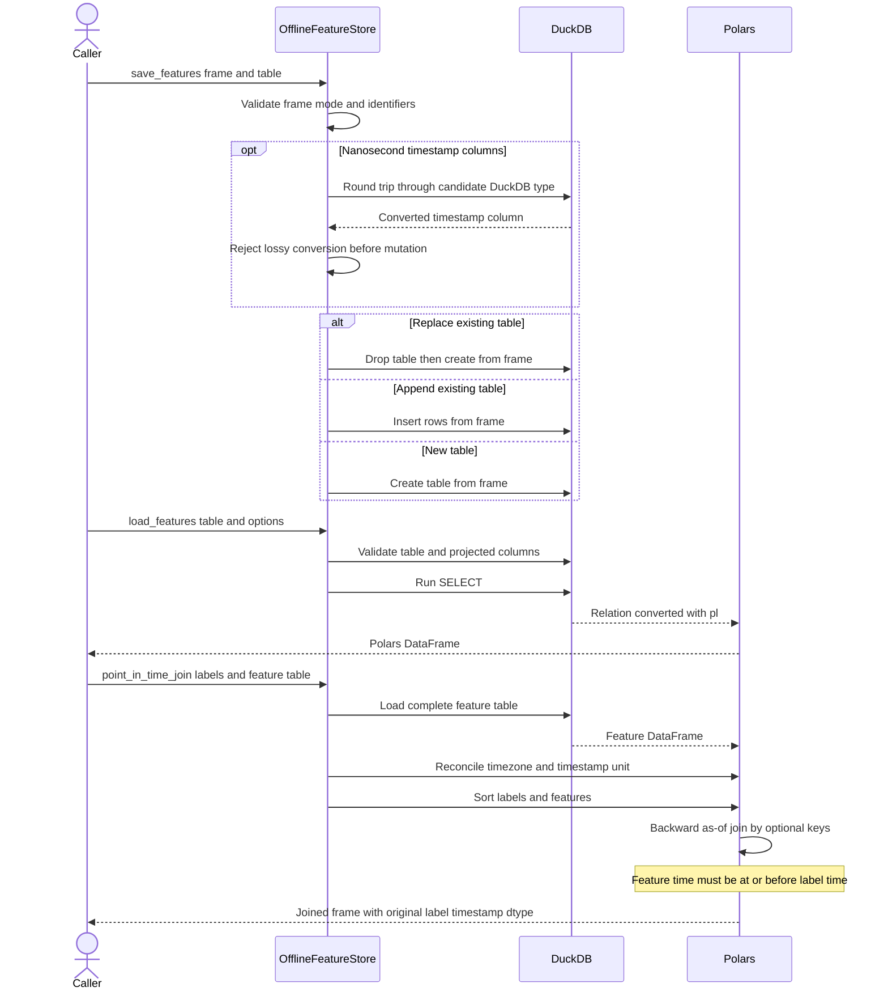

# Offline Feature Store Operations

`OfflineFeatureStore` is an optional local persistence layer for computed feature tables. It connects Polars data frames to an in-memory or file-backed DuckDB database and provides table discovery, three write modes, projected and filtered reads, and backward as-of joins for training-set construction. The public imports are `OfflineFeatureStore` and `FeatureStoreError` from `ml4t.engineer.store`.

This store is deliberately separate from the main feature computation and dataset workflows. Use it when features must survive between runs or when several datasets reuse a materialized feature table. See [Dataset Preprocessing](../architecture/dataset-preprocessing.md), [System Map](../architecture/system-map.md), and [Temporal Data Contracts](../concepts/temporal-data-contracts.md) for the surrounding data-flow and leakage rules.

## Installation and optional-dependency boundary

DuckDB and PyArrow are in the `store` optional dependency group rather than the package's core dependencies:

```bash
pip install "ml4t-engineer[store]"
```

Importing `ml4t.engineer.store` remains possible when DuckDB is absent because the module catches the DuckDB `ImportError`. The failure boundary is construction: `OfflineFeatureStore(...)` raises `FeatureStoreError` with an installation hint. Other connection failures, including an invalid database file or an unavailable read-only database, are also wrapped as `FeatureStoreError`. Polars is a core dependency and is imported normally, so this optional boundary applies specifically to DuckDB.

## Connection lifecycle

Construction connects immediately:

- `OfflineFeatureStore()` opens `:memory:`. Its tables disappear when the connection closes.
- `OfflineFeatureStore(path)` creates parent directories and opens a persistent DuckDB file in read-write mode.
- `OfflineFeatureStore(path, read_only=True)` requests a read-only connection. Read operations remain available, while attempted writes are rejected by DuckDB and surfaced through the store's error boundary.

Prefer the context manager because `__exit__` always calls `close()`, including when the body raises:

```python
import polars as pl
from ml4t.engineer.store import OfflineFeatureStore

features = pl.DataFrame(
    {
        "timestamp": ["2025-01-02", "2025-01-03"],
        "symbol": ["AAPL", "AAPL"],
        "momentum": [0.2, 0.4],
    }
)

with OfflineFeatureStore("data/features.duckdb") as store:
    store.save_features(features, "daily_features")
    restored = store.load_features("daily_features")
```

`close()` is idempotent, clears the internal connection even if closing emits a warning, and makes subsequent access through `connection` fail with `FeatureStoreError`. `is_connected()` only reports whether that internal connection reference is present. There is no public reconnect method; after closing, create a new store instance rather than relying on the private `_connect()` method. The destructor is a final fallback, not a substitute for deterministic context-manager cleanup.

`list_tables()` reports tables in DuckDB's `main` schema, and `table_exists()` checks membership in that list. `connection` and `execute(query)` are escape hatches for DuckDB-specific operations; callers using them own the safety and portability of their SQL.

## Save and load semantics

`save_features(df, table_name, mode="replace")` accepts only a non-empty `pl.DataFrame`. It validates the mode and table identifier before changing the database.

| Mode | Existing table | Missing table |
|---|---|---|
| `replace` | Drop it, then create a table from the incoming frame | Create a table from the frame |
| `append` | Insert incoming rows with `INSERT ... SELECT *` | Create a table from the frame |
| `fail` | Raise `FeatureStoreError` without changing it | Create a table from the frame |

Append is positional: the implementation inserts `SELECT * FROM df` into the existing schema. Operators should therefore keep column order, count, and DuckDB-compatible types aligned with the destination. The API does not perform a general schema-name reconciliation before insertion; incompatible inserts are wrapped as `FeatureStoreError`.

`load_features(table_name, columns=None, filter_expr=None, limit=None)` checks that the table exists, validates a requested column list against DuckDB metadata, constructs a `SELECT`, and converts the DuckDB relation back with `.pl()`. Projection preserves caller-specified column order. `limit` must be a positive integer. Empty results retain their schema, and Arrow/Polars conversion preserves values such as nulls in the tested round trip.

`filter_expr` is deliberately inserted as a raw SQL `WHERE` expression, and `execute()` accepts raw SQL. Treat both as trusted-code interfaces: do not place untrusted user input in either argument. Table and projected-column parameters receive the stricter identifier handling described below.



*The store validates and moves tables through DuckDB, while Polars performs the backward as-of join that enforces the no-future-feature rule.*

## Identifier and query defenses

Table names and projected column names pass through `_quote_identifier`. The function:

1. requires a non-empty string;
2. rejects NUL, semicolon, `--`, `/*`, and `*/` tokens; and
3. wraps the identifier in double quotes while doubling embedded quotes.

This permits legitimate identifiers such as `feature table "daily"`, spaces, hyphens, and dots without allowing those parameters to terminate a SQL statement. Requested load columns are also checked against `information_schema.columns` before query execution, producing an explicit unknown-column error with the available schema. Point-in-time joins access the feature table through `load_features`; their timestamp and grouping names are passed to Polars rather than interpolated into SQL.

These defenses are parameter-specific, not a general SQL sandbox. In particular, `filter_expr`, `execute()`, and direct use of `connection` remain raw SQL surfaces.

## Timestamp precision and rejected writes

Timestamp validation exists to prevent storage from moving a feature backward in time and making it eligible too early. Before a write mutates a table, precision-sensitive `Datetime` columns are round-tripped through DuckDB:

- for a new or replacement table, incoming nanosecond columns are tested against DuckDB's inferred representation;
- for append to an existing table, every incoming `Datetime` column is cast to its positional destination type and tested;
- the result is cast back to the original Polars unit and compared as integer clock values.

A lossy result raises `ValueError` stating that the table has not changed. This protects an existing table from rejected lossy `replace` and `append` operations. DuckDB versions and destination schemas differ: aware nanoseconds are supported by DuckDB 2, while older engines or microsecond destination columns may require callers to normalize timestamps explicitly before writing.

The preservation guarantee is narrower than full transactional replacement. Validation and `mode="fail"` rejection occur before `DROP TABLE`, but a valid `replace` of an existing table is implemented as separate drop and create statements without an explicit transaction. If creation fails after the drop for a reason not caught by preflight validation, the old table is not guaranteed to survive. For operationally critical replacement, validate the full schema first and use an external transaction or staging-and-rename process through the DuckDB connection.

Append execution errors are wrapped as `FeatureStoreError`; focused tests verify that rejected precision conversion and an incompatible timestamp append leave existing rows intact. Ordinary Python contract errors remain `TypeError` or `ValueError`, while DuckDB/conversion failures are generally wrapped as `FeatureStoreError`.

## Leakage-safe point-in-time joins

`point_in_time_join(labels, features_table, timestamp_col="timestamp", join_keys=None, tolerance=None)` loads the complete feature table into Polars, sorts both sides by the grouping keys and timestamp, and runs `join_asof(..., strategy="backward")`. For each label it selects the most recent row satisfying:

- the feature timestamp is less than or equal to the label timestamp;
- every optional `join_keys` value matches; and
- the age of the feature does not exceed `tolerance`, when provided.

An exact timestamp is eligible. A label earlier than all matching features is retained with null feature values. `tolerance` uses Polars duration syntax such as `"10m"`, `"1h"`, or `"1d"`; it limits staleness and never relaxes the no-future rule. Without a tolerance, arbitrarily old matching features remain eligible. Duplicate feature rows with the same timestamp have no documented deterministic tie-break beyond the underlying sorted as-of behavior, so feature producers should enforce uniqueness per timestamp and grouping key where reproducibility matters.

### Timezone and unit reconciliation

For timezone-aware timestamps on both sides, DuckDB may return `TIMESTAMPTZ` in the connection timezone. The store converts the feature timestamp to the labels' timezone before joining, so comparison is by instant and changing DuckDB's session timezone does not change eligibility. Naive timestamps are not assigned an implicit timezone. Producers should not mix naive and aware clocks and should follow the repository's [Temporal Data Contracts](../concepts/temporal-data-contracts.md).

When both keys are `Datetime` but have different precision, both sides are promoted to the finer of `ms`, `us`, and `ns`. Each conversion is round-tripped to detect overflow rather than rounding or wrapping silently. Failure is surfaced as `FeatureStoreError` from the point-in-time operation. After joining, the label timestamp is cast back to its original dtype, preserving the caller-facing label clock. Tests cover mixed units in both directions, aware and naive clocks, nanosecond features that must remain ineligible for an earlier microsecond label, DST-adjacent instants, and far-future overflow.

Input labels must be a non-empty Polars frame containing `timestamp_col`; requested grouping keys must exist in labels. The implementation relies on Polars to reject a missing or incompatible timestamp/key on the feature side, and wraps such join-time failures as `FeatureStoreError`. Because the method sorts before joining, result row order follows the join sort rather than necessarily preserving the input label order.

## Failure checklist

Before running a persistent job:

- Install the `store` extra and open the file once in the intended read/write mode.
- Use a context manager, especially in tests and batch jobs.
- Keep append frames schema-compatible and in destination column order.
- Normalize timestamp precision deliberately if the deployed DuckDB version or existing table cannot preserve nanoseconds.
- Reserve `filter_expr`, `execute()`, and `connection` for trusted SQL.
- Provide entity keys such as `symbol` to prevent cross-entity as-of matches.
- Set a tolerance when stale features should become null.
- Treat replace as drop-then-create, not as an atomic swap.
- Make feature timestamps unique per key or define upstream deduplication.

The focused suite in `tests/store/test_offline.py` exercises lifecycle and persistence, all write modes, SQL identifier rejection and quoted names, projections/filters/limits, conversion behavior, preservation after rejected writes, timezone and precision boundaries, tolerance, and the no-look-ahead invariant. Broader repository expectations are summarized in [Quality Gates](../testing/quality-gates.md).
