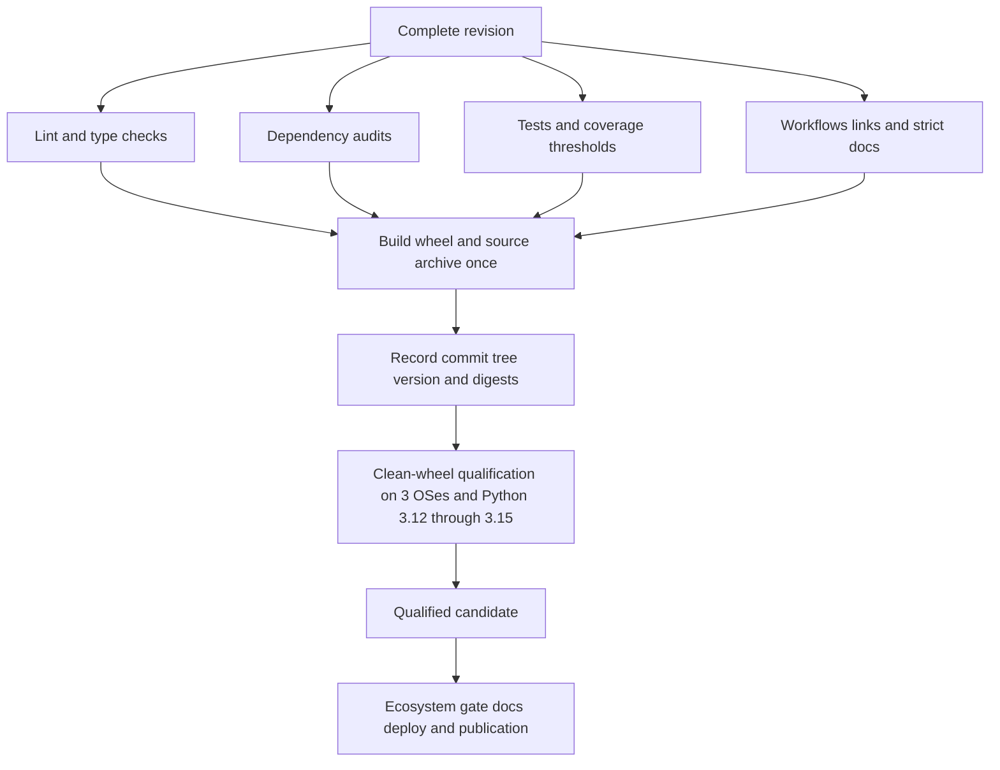

# Testing, Validation, and Release Gates

A narrow test is an iteration tool, not release qualification. Use the smallest test that can expose the behavior while developing, then run every applicable repository gate on the complete final revision. CI deliberately qualifies the built artifact—not merely an editable source checkout—across the supported Python and operating-system matrix.

For subsystem context, see [Feature Computation](../architecture/feature-computation.md), [Labeling Runtime](../architecture/labeling-runtime.md), [Offline Feature Store](../operations/offline-feature-store.md), and [Adding or Changing Features](../workflows/adding-or-changing-features.md).

## Two levels of validation

### Narrow iteration

Start with a file, class, or test node close to the change. Examples:

```bash
uv run pytest tests/core/test_registry.py -q
uv run pytest tests/test_registry_lookbacks.py -q
uv run pytest tests/test_labeling_time_contract.py -q
uv run pytest tests/store/test_offline.py -q
uv run pytest tests/test_talib_accuracy.py -q
```

The repository's pytest configuration adds strict marker checking and coverage for `ml4t.engineer`, enables **branch coverage**, and applies `-m "not perf"`. Consequently, an ordinary `uv run pytest ...` excludes tests marked `perf`; selecting a performance file without overriding the marker expression is not enough. Run performance checks explicitly, normally without coverage instrumentation:

```bash
uv run pytest -m perf --no-cov tests/test_performance.py -q
```

Property tests are part of the ordinary suite and can also be selected explicitly:

```bash
uv run pytest -m property tests/test_property_based.py -q
```

Optional reference suites skip when their dependency is absent: TA-Lib modules use `pytest.importorskip("talib")`, and store, calendar, statistics, and visualization tests follow the same pattern for their extras. A skip therefore does not prove optional integration behavior. Install the relevant extra and confirm that the intended tests ran rather than skipped.

### Final repository qualification

Before review, run the complete applicable local checks from a synchronized development environment:

```bash
uv sync --dev --extra docs --extra ta --extra store --extra viz
uv run ruff check src/ tests/ examples/ scripts/
uv run ruff format --check src/ tests/ examples/ scripts/
uv run ty check
uv run pytest tests/ -q
uv build
uv run python -c "import ml4t.engineer"
uv run mkdocs build --strict
```

These commands are a local preflight, not a substitute for hosted qualification. The full CI builds one source distribution and wheel only after lint, type checking, dependency auditing, coverage, and documentation pass. It then installs that wheel into a clean environment and runs the installed-wheel checks in all 12 combinations of Ubuntu, macOS, and Windows with Python 3.12, 3.13, 3.14, and 3.15.



*The qualification flow binds all downstream checks and publication to one immutable candidate rather than rebuilding after tests.*

## Change-to-test map

The entries below are minimum focused coverage. Always add the full repository qualification above, plus any affected optional or integration lanes.

| Change type | Focused iteration | Additional contract or qualification |
|---|---|---|
| Feature implementation or numerical kernel | The closest module under `tests/features/`; relevant cases in `tests/test_talib_accuracy.py` and the P0–P3/remaining TA-Lib suites | Run `tests/test_registry_lookbacks.py`, `tests/test_all_features_integration.py`, and relevant API/catalog tests. Exercise eager and lazy forms and output shape/null warm-up behavior. Run property and explicit performance tests when mathematical invariants or a hot path change. Feature/core changes also trigger native stress qualification. |
| Registry metadata, defaults, dependencies, normalization, or lookback | `tests/core/test_registry.py`, `tests/test_registry_lookbacks.py`, `tests/test_catalog.py` | Registry names must be covered exactly by the authoritative lookback table; metadata defaults must match callable defaults; configured lookbacks must equal the first usable runtime output. Run all-feature and public `compute_features` integration tests. |
| Data schema or shared contract | `tests/core/test_schemas_coverage.py`, `tests/test_data_contract_config.py`, and the affected API/input-contract test | Check required columns, dtypes, eager/LazyFrame behavior, validation failures, serialization, and compatibility with `ml4t-specs`. Shared cross-library contract changes originate in `ml4t-specs` and require ecosystem qualification. |
| Labeling, horizons, calendars, or timestamps | `tests/test_labeling_time_contract.py`, `tests/test_labeling_session_windows.py`, `tests/test_labeling_calendar.py`, and the affected forward-return or empty-schema tests | Cover observation, session, elapsed, and expected-bar semantics as applicable; disabled versus inherited calendars; timezone/timestamp semantics; per-asset ordering; missing scheduled bars; null output schema; and serialization round trips. |
| Bars or temporal grids | Tests under `tests/bars/`, plus `tests/test_api_bar_grid.py` and/or `tests/test_api_session_grid.py` | Exercise ordering, sessions/breaks, partial-bar policy, empty input, and multi-asset behavior. Public time-contract changes also require labeling and ecosystem regressions. |
| Preprocessing or dataset preparation | `tests/test_preprocessing.py`, `tests/test_analytical_input_preparation.py`, `tests/test_feature_panel_preparation.py` | Prove transformations fit on training data only and preserve leakage-safe temporal alignment and presentation contracts. |
| Offline feature store | `tests/store/test_offline.py` with the `store` extra installed | Cover DuckDB/PyArrow persistence and the affected schema/time-contract boundary; see [Offline Feature Store](../operations/offline-feature-store.md). |
| Optional dependency or fallback | The affected optional test plus `tests/utils/test_dependencies.py`; use a subprocess/minimal environment where import state matters | Test both installed and missing-dependency paths. The base import must remain usable without optional packages. Do not treat an `importorskip` result as coverage of the installed path. |
| Performance-sensitive code | Closest correctness tests first, then `uv run pytest -m perf --no-cov tests/test_performance.py -q` | Warm JIT-backed functions before comparisons, use representative sizes, and apply the indicator-complexity threshold where used. Performance never replaces numerical or contract correctness. |
| Documentation or examples | `uv run python tests/documentation_workflows.py`, README link checker when README changes, and `uv run mkdocs build --strict` | CI executes documented workflows and checks every README link before strict MkDocs build. Documentation changes are gated even when runtime code is untouched. |
| Packaging, dependencies, CI, or release scripts | `tests/test_release_candidate.py` and `tests/test_release_policy.py` | Build distributions, run `twine check`, verify metadata/files, candidate identity and SHA256 manifest, clean-wheel origin/bytes, the full matrix, dependency audits, security workflows, and release verification. |

## Numerical and feature contracts

### Independent correctness, not output preservation

A numerical change needs an intended definition and independent evidence. Existing output is not its own oracle. The TA-Lib suites compare representative indicators, periods, edge cases, NaN behavior, and warm-up positions against TA-Lib, generally with explicit `assert_allclose` tolerances. `tests/test_accuracy_validation.py` adds patterned RSI inputs and a strict `1e-6` check; its helper functions intended for report-style execution are not all pytest test cases, so do not assume that merely collecting the file runs every helper.

TA-Lib parity applies only where the implementation intentionally shares TA-Lib semantics. For project-specific features, use a direct formula, another independent implementation, or a hand-computed fixture. Property tests complement examples by ranging over generated financial inputs and asserting invariants such as moving-average bounds, non-negative ATR/volatility, bounded RSI/correlation, and VaR ordering. They do not establish exact reference parity.

### Registry and schema consistency

Registered features have coupled contracts: implementation signature, registry metadata, column dependencies, defaults, normalization metadata, and lookback. `tests/test_registry_lookbacks.py` compares the registry with the authoritative lookback table, checks metadata defaults against function signatures, and computes the first usable output row for default and configured parameters. This catches metadata that looks plausible but causes incorrect data sufficiency or warm-up planning at runtime.

Schema tests cover more than column presence. They verify exact core schema membership, numeric types, required entity/time columns, OHLC consistency, negative-price rejection, flexible time-column behavior, and the reduced validation possible for a `LazyFrame`. When changing an input or output contract, test both acceptance and failure semantics at the public entrypoint, not only the helper validator.

## Temporal regression discipline

Temporal changes are cross-cutting. A labeling or bar-grid patch can affect configuration precedence, serialization, schedule adapters, per-asset scanning, return horizons, and persisted dtypes. Focused regressions should pin:

- explicit argument precedence over config and feed metadata without mutating either input;
- the distinction among an omitted calendar, a named calendar, and `calendar=None`;
- timezone and timestamp semantics instead of inference from aware values;
- session breaks, holidays, missing expected bars, and partial-bar policy;
- stable input order with independent per-asset calculation;
- empty/inactive assets retaining compatible label dtypes; and
- date, microsecond, and nanosecond representations, including Parquet round trips.

These checks are especially important for shared `ml4t-specs` time contracts. The repository release policy verifies that the dependency is an indexed, bounded runtime requirement, while the external ecosystem workflow tests the cross-repository contract.

## Optional dependency isolation

Core dependencies and extras are intentionally distinct. Extras include `ta`, `store`, `calendars`, `stats`, `viz`, and `ml`; packages such as SciPy, Statsmodels, PyArrow, Matplotlib, LightGBM, and SHAP are not all base requirements. Safe changes must preserve both sides of the boundary:

1. importing `ml4t.engineer` in a base environment must not eagerly require an extra;
2. selecting an extra-backed operation should either work with the extra installed or raise the documented actionable error/fallback when absent;
3. tests that simulate absence should use a fresh process when module import caching could hide the dependency; and
4. installed-extra tests must actually execute, not silently skip.

`tests/test_hurst_core_dependency.py` is a representative isolation regression: a fresh subprocess blocks SciPy and verifies registered Hurst computation for eager and lazy inputs, including exact selected values and preservation of source columns. CI separately imports the optional ML stack in every clean-wheel matrix cell, which catches binary and version compatibility problems that source-only tests miss.

## Coverage, static checks, and security

The coverage job disables Numba JIT for measurement, emits JSON, and applies independent line and branch thresholds through `scripts/check_coverage.py`. Repository totals must reach 90% line and 85% branch coverage. Release-critical orchestration, registry/schema, bars, labeling, dataset, and preprocessing modules must individually reach 95% line and 90% branch coverage (a critical module with no branches is treated as fully branch-covered). A passing focused test can therefore still fail the release gate because another path or a newly added branch is uncovered.

Static gates are separate:

- Ruff lint and format checks cover `src/`, `tests/`, `examples/`, and `scripts/`.
- `ty check` covers `src` under the configured Python 3.12 type environment; each installed-wheel matrix cell also checks against that cell's Python version.
- The CI dependency audit exports and audits both the locked core runtime and the complete all-extras/all-groups environment.
- The security workflow runs dependency review on pull requests, failing at high severity, and runs Python CodeQL on pull requests, `main`, a weekly schedule, and manual dispatch.
- Release-policy regressions require all external GitHub Actions to be pinned to full commit SHAs.

## Artifact and release gates

### Build once, test what will ship

After the prerequisite jobs pass, CI builds the sdist and wheel once. `scripts/ci/candidate.py` records the source commit, Git tree, package version, artifact metadata, and SHA256 digests. `twine check` and candidate verification reject malformed metadata or identity drift.

Each matrix cell downloads that same candidate, verifies its commit/tree identity, exports locked test requirements without installing the project from source, creates `.artifact-venv`, installs the candidate wheel first, then installs test dependencies. The installed-candidate verifier rejects imports shadowed by `src`, a mismatched installed version, or modified installed package bytes. The cell then imports the optional ML dependencies, runs `ty`, the full default installed-wheel pytest suite with `--no-cov`, and documented workflows. This clean-wheel path detects missing package data, undeclared dependencies, wheel-only import failures, and platform-specific native issues.

The path-filtered and weekly native-stress workflow adds ten fresh-process native/cold-call repetitions against a built wheel for feature/core changes. A monthly Python 3.15 dependency canary probes current core requirements and selected API/bar tests in isolation, but it is `continue-on-error`; it is early warning, not a replacement for the required Python 3.15 cells in the main matrix.

### Ecosystem and publication

The ecosystem workflow calls the pinned `ml4t/ecosystem` reusable qualification on pull requests and `main`, using `ml4t.engineer` as the import package. A release dispatch requires an unused PEP 440 version and a full candidate commit that is simultaneously the workflow revision and current `main`. Release qualification reruns both ecosystem and repository CI, then selects only the candidate that matches the expected commit, tree, version, and manifest.

Publication is ordered and fail-closed: qualified revision-identified documentation is built strictly and deployed first; deployment identity is verified; the already-qualified artifacts are published to PyPI using trusted publishing; a GitHub release/tag is created at the candidate commit; and post-publication checks compare PyPI and GitHub artifact digests, install the published wheel, run the README quick start, and recheck deployed documentation identity. No release job rebuilds the package.

## Failure interpretation

- **A focused test passes but CI fails:** the change is not qualified. Investigate the failed independent gate or matrix cell; do not narrow the claim to the focused test.
- **An optional suite skips:** install the extra or use the appropriate CI lane and confirm execution.
- **Source tests pass but clean-wheel import fails:** suspect missing package data, source-tree shadowing, an undeclared dependency, or artifact identity drift.
- **One OS/Python cell fails:** treat it as a supported-platform regression. The declared support matrix is not best effort.
- **Coverage falls:** add behaviorally meaningful tests; do not weaken thresholds or exclude production paths.
- **Numerical parity fails:** first establish the intended definition, initialization, warm-up, NaN, and tolerance semantics. Do not update expected values merely to preserve the new output.
- **Temporal tests fail only around calendars:** inspect declaration precedence, timezone/timestamp semantics, breaks, and expected-grid completeness before changing fixtures.
- **Release identity or digest verification fails:** stop publication. Rebuilding would create a different candidate and must go through qualification again.

## Source references

- [Pytest, extras, static, and coverage configuration](../../pyproject.toml)
- [Main CI and clean-wheel matrix](../../.github/workflows/ci.yml)
- [Release workflow](../../.github/workflows/release.yml)
- [Native stress workflow](../../.github/workflows/native-stress.yml)
- [Ecosystem qualification](../../.github/workflows/ecosystem.yml)
- [Python 3.15 dependency canary](../../.github/workflows/python315-canary.yml)
- [Security workflow](../../.github/workflows/security.yml)
- [Contributor requirements](../../CONTRIBUTING.md)
