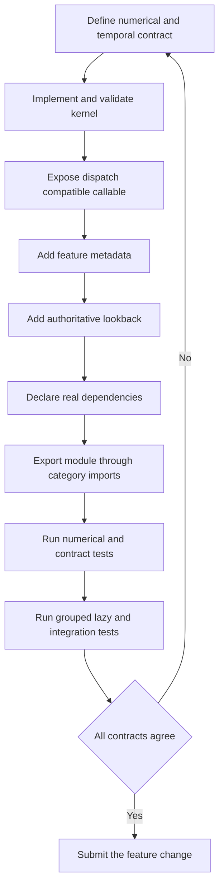

# Adding or Changing a Registered Feature

A registered feature is not just its numerical kernel. Treat the implementation, function defaults, registry metadata, normalization and range classification, authoritative lookback, dependencies, dispatch-compatible arguments, package exports, grouped/lazy behavior, and tests as **one consistency unit**. A change is complete only when the direct function and `compute_features()` tell the same story.

For runtime context, see [Feature Computation](../architecture/feature-computation.md), [Temporal Data Contracts](../concepts/temporal-data-contracts.md), and the user-facing [Quickstart](../quickstart.md). The release-level test expectations are summarized in [Quality Gates](../testing/quality-gates.md).

## The contract to design first

Before coding, write down:

1. **Identity and semantics:** unique registry `name`, category, description, formula, inputs, output shape, and whether TA-Lib compatibility is claimed.
2. **Callable contract:** required market columns and configurable parameters, including validation and exact defaults.
3. **Numerical contract:** first usable output, missing-value behavior, initialization, recursion, boundedness, and reference tolerance.
4. **Execution contract:** direct NumPy/Polars use, expression output for `compute_features()`, per-asset isolation, eager/lazy parity, and any temporal-window support.

Use [RSI](../../src/ml4t/engineer/features/momentum/rsi.py) as a representative recursive, bounded feature: it accepts array/Series input directly, returns a `pl.Expr` when dispatched with a column name, restarts Wilder smoothing after gaps, advertises `(0, 100)`, and first becomes usable at index `period`. [ATR](../../src/ml4t/engineer/features/volatility/atr.py) shows the equivalent multi-column pattern for `high`, `low`, and `close`.

## End-to-end workflow



*The workflow closes the loop whenever implementation, metadata, dispatch, warm-up behavior, or integration results disagree.*

### 1. Implement the numerical behavior

Place the implementation in the appropriate category. Follow neighboring modules rather than inventing a new calling convention. In particular:

- Validate parameter domains at the public function boundary.
- Preserve output length and make warm-up values explicit, normally as `NaN` or null.
- Define behavior for short inputs, constant data, missing observations, and invalid periods.
- If reference compatibility matters, reproduce the reference initialization and smoothing—not merely the steady-state formula.
- For direct calls, support the types promised by the annotation and docstring. For registry execution, required market-column arguments must accept column-name strings and yield Polars expressions.

A typical single-input shape is:

```python
def candidate(
    close: npt.NDArray[np.float64] | pl.Series | str,
    period: int = 14,
) -> npt.NDArray[np.float64] | pl.Expr:
    if period < 1:
        raise InvalidParameterError(...)
    if isinstance(close, str):
        return candidate_polars(close, period)
    ...
```

Do not return an eager array from the string-dispatch path. Registry execution accepts a `pl.Expr`, a dictionary of expressions, or a tuple/list of expressions; it applies expressions with `over(group_cols)` and appends them with `with_columns`, preserving a `LazyFrame`. Multi-output dictionary keys become `<output>_<key>` and tuple/list positions become `<output>_<index>`. Output collisions are rejected rather than overwritten. See [`_execute_feature`](../../src/ml4t/engineer/api.py) and [`_append_feature_expressions`](../../src/ml4t/engineer/api.py).

### 2. Make the signature dispatch-compatible

[`COLUMN_ARG_MAP`](../../src/ml4t/engineer/core/dispatch.py) is the dispatch vocabulary. Required parameters named `open`, `high`, `low`, `close`, `volume`, `returns`, and the documented aliases are populated from canonical input columns. `implementation` is always passed as a keyword when configured.

Therefore:

- Prefer existing column argument names. A novel required argument is treated as a configuration parameter and fails unless metadata or the request supplies it.
- Add a new mapping only when it is a genuine shared input convention; assess every caller before changing global dispatch.
- Keep configurable defaults in the function signature. The decorator derives metadata defaults from it.
- If a required non-column parameter has no function default, provide it in `parameters={...}`. Otherwise `compute_features()` cannot execute the default request.
- Test the callable through `compute_features()`, not only by calling the kernel directly. Signature/API mismatches are integration failures.

Request parameters are validated against the callable signature before execution. Unknown parameters, duplicate output names, and output/input-column conflicts fail before any feature runs.

### 3. Register complete, truthful metadata

Apply [`@feature`](../../src/ml4t/engineer/core/decorators.py) to the public callable. Supply the stable name, category, description, formula when useful, normalization classification, range, compatibility claim, input/output descriptions, dependencies, references, and searchable tags.

Defaults have a hard consistency rule: a key in `parameters` must exist in the signature, and if the signature already has a default, the two values must match. The decorator records all non-column signature defaults automatically. Duplicate names are rejected by the global registry at import time.

`normalized=True` means scale-invariant or directly ML-ready in the registry’s classification—not proof of statistical stationarity. Use it for bounded oscillators, returns, ratios, or explicitly normalized values. Use `normalized=False` for price-level, cumulative, volume-level, or price-unit volatility outputs. Supply `value_range` for bounded outputs; a normalized feature without a range and a bounded range without `normalized=True` both produce warnings. The range must describe actual outputs, including edge cases, rather than an aspirational clipping range. See [`FeatureMetadata`](../../src/ml4t/engineer/core/registry.py).

### 4. Define the authoritative lookback

For first-party features, add the feature name to [`FEATURE_LOOKBACKS`](../../src/ml4t/engineer/core/lookbacks.py) and **omit** `lookback=` from the decorator. The table is authoritative and its calculator receives the merged defaults plus request overrides. A lookback is the zero-based index of the first structurally usable output, not simply “the number of rows read.” For example, a `period`-row rolling mean commonly has lookback `period - 1`, while RSI and ATR first produce at index `period`.

Choose a calculator matching the real algorithm: constant, parameter plus adjustment, scaled parameter for recursive stages, maximum or sum for composed windows, or a dedicated function for a genuinely special warm-up. Verify default and non-default cases empirically. The bound result must be a non-negative integer and not a Boolean.

Only third-party feature names absent from `FEATURE_LOOKBACKS` may declare decorator `lookback=` as an integer, parameter name, or callable. A first-party table entry plus a decorator declaration is intentionally rejected, preventing two sources of truth.

### 5. Declare dependencies precisely

`dependencies=[...]` records feature-to-feature ordering. During a request, `compute_features()` topologically orders **requested** features and rejects cycles. It does not automatically insert dependencies omitted by the caller. Consequently, declare only genuine registry-feature dependencies, ensure dependent and prerequisite features can be requested together, and add an ordering/cycle test when introducing dependency edges. Do not use dependencies as a substitute for raw-column requirements or Python imports.

### 6. Decide temporal-window support explicitly

Observation and expected-bar windows preserve the feature’s ordinary row/bar interpretation. Session and elapsed windows are a narrower extension for finite-window algorithms whose same kernel can be evaluated over a causally selected set of original bars.

Currently only `sma`, `stddev`, and `realized_volatility` support session or elapsed periods. Session periods are positive integer session counts. Elapsed periods are positive fixed durations over physical UTC time; session-label timestamps cannot define them. The temporal executor computes causal window sizes per group and reuses the finite row kernel without resampling.

Do **not** silently reinterpret other indicators:

- A recursive indicator such as EMA, RSI, or ATR carries state from all preceding updates. Replacing its period with the varying count of bars in a session or duration changes its recurrence and initialization; it is not the same indicator.
- A multi-window indicator has several periods with distinct roles. Mapping one temporal duration to those windows is ambiguous and can alter stage ordering and warm-up.

Such features must reject `window_unit="session"` and `window_unit="elapsed"`. If adding temporal support, it must be a deliberate finite-window design added to [`temporal_period`](../../src/ml4t/engineer/core/temporal_windows.py), with schedule completeness, group isolation, eager/lazy parity, and duration-boundary tests—not a row-count conversion.

### 7. Expose imports and trigger registration

Registration occurs at import time, while the decorator returns the original function unchanged. Add the module to its category `__init__.py` so importing the category both exposes the public symbol and executes the decorator. The aggregate [`features/__init__.py`](../../src/ml4t/engineer/features/__init__.py) imports all categories, and package import reaches `features`, populating the global registry before `compute_features()` is used.

Check all three paths:

```python
from ml4t.engineer.features.<category>.<module> import candidate
from ml4t.engineer.features.<category> import candidate
from ml4t.engineer import compute_features
```

Keep `__all__` accurate in the implementation module. Missing category imports create the deceptive state where direct module calls work but the normal package registry never sees the feature.

## Select tests by risk

A safe change normally combines four layers.

### Numerical tests

Add focused tests beside the feature family for defaults, parameter variants, short input, constant/trending data, gaps, and output bounds. For TA-Lib claims, compare against TA-Lib with a justified tolerance and `equal_nan=True`; match warm-up locations as well as values. Existing reference suites include [`test_all_indicators_accuracy.py`](../../tests/test_all_indicators_accuracy.py) and [`test_talib_accuracy.py`](../../tests/test_talib_accuracy.py).

### Registry and lookback contract tests

Use [`tests/core/test_registry.py`](../../tests/core/test_registry.py) for decorator/metadata validation patterns. [`test_registry_lookbacks.py`](../../tests/test_registry_lookbacks.py) enforces exact coverage between the registry and `FEATURE_LOOKBACKS`, metadata/signature default agreement, and equality between declared lookbacks and first usable outputs for default and configured parameters. Add a configured case when the feature has a meaningful parameterized warm-up.

### API, grouping, lazy, and temporal tests

Exercise `compute_features()` with default and overridden parameters. Compare a mixed-asset panel with independently computed assets to catch cross-asset leakage. Pass a `LazyFrame`, assert the result remains lazy, then collect and compare it with eager output. For supported temporal features, test session/elapsed boundaries and incomplete schedules; for recursive or multi-window features, test explicit rejection. [`test_api_temporal_windows.py`](../../tests/test_api_temporal_windows.py) contains these temporal patterns.

### Whole-registry integration

[`test_all_features_integration.py`](../../tests/test_all_features_integration.py) checks registry population, individual and combined execution, metadata completeness, and panel isolation. A new registration changes registry-wide expectations, including any explicit feature count. Do not “fix” the count without also proving the feature imports and executes.

A focused local sequence is:

```bash
pytest tests/features/<category> -q
pytest tests/core/test_registry.py tests/test_registry_lookbacks.py -q
pytest tests/test_api.py tests/test_api_temporal_windows.py -q
pytest tests/test_all_features_integration.py -q
pytest tests/test_all_indicators_accuracy.py tests/test_talib_accuracy.py -q
```

Adjust the first path to the actual feature test file. TA-Lib suites skip when the optional dependency is unavailable; passing only the non-reference suites does not substantiate `ta_lib_compatible=True`.

## Pre-merge consistency checklist

- [ ] Function name, registry name, docs, and output names agree.
- [ ] Direct numerical path and string-to-`pl.Expr` path implement the same formula and warm-up.
- [ ] Required input argument names are dispatchable.
- [ ] Signature defaults and metadata defaults match exactly.
- [ ] `normalized` and `value_range` describe real output behavior.
- [ ] `FEATURE_LOOKBACKS` predicts the first usable default and configured outputs.
- [ ] Dependencies are real, acyclic, and tested as requested features.
- [ ] Session/elapsed behavior is either correctly implemented for a finite window or explicitly rejected.
- [ ] Module, category, and package imports trigger one registration and expose the intended symbol.
- [ ] Eager, lazy, grouped, numerical, contract, and whole-registry tests cover the change.
